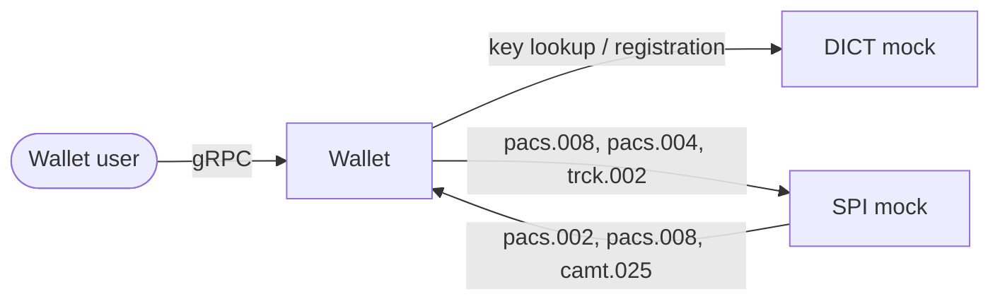

# pix_fake

A Pix wallet built against mocks of the Bacen infrastructure. Only regulated participants can reach the real Pix, so
this repo mocks the **DICT** (key directory) and the **SPI** (settlement) with the same contracts Bacen documents, and
the wallet talks to them exactly as it would to the real thing. Going live is a config change.

| Part | What | Docs |
|------|------|------|
| `mock/dict` | DICT API v2.13.0: Pix keys, HTTP + XML | [README](mock/dict/README.md) |
| `mock/spi` | SPI: ISO 20022 payments, returns, reports | [README](mock/spi/README.md) |
| `wallet` | The wallet: Go + gRPC, its own DB, independent of the mocks | [README](wallet/README.md) |



Flows and diagrams: [architecture](docs/architecture.md). Building a participant against the mocks:
[integration guide](docs/integration-guide.md). Plan and decisions: [roadmap](docs/roadmap.md).

## Running

Needs Go 1.27.3+ and Docker.

```sh
make up                # both mocks + the wallet's database (DICT :8080, SPI :8081, wallet DB :5434)
cd wallet
go run ./cmd/api       # gRPC on :9090
go run ./cmd/worker    # in another terminal
make down
```

| Target | |
|--------|-|
| `make setup` | only the mocks, with seed data |
| `make check` | closing test against `make setup` |
| `make reset` | mocks back to their seed |
| `make test` | unit tests, no database |
| `make test-integration` | everything on PostgreSQL |
| `make e2e` | mocks + wallet end to end, on throwaway databases (stop `make up` first) |
| `make coverage` | e2e + unit coverage of the wallet |
| `make lint` | gofmt + go vet |

## What is simplified

No mTLS, ICP-Brasil certificates or XML signatures: the caller is identified by `X-Participant-ISPB` (DICT) or the
`{ispb}` in the path (SPI). No real settlement or liquidity on Bacen's side. Each mock lists its own simplifications.

## Layout

```
mock/dict, mock/spi     the mocks, each with its own module, DB and README
wallet/                 the wallet; shares nothing with mock/
e2e/                    closing test of the two mocks together
scripts/                e2e.sh, coverage.sh
docs/                   architecture, integration guide, roadmap
```

## References

- Pix at Bacen: https://www.bcb.gov.br/estabilidadefinanceira/pix (technical docs and the SPI manuals)
- DICT API: https://www.bcb.gov.br/content/estabilidadefinanceira/pix/API-DICT.html
- Bacen Pix API (OpenAPI): https://github.com/bacen/pix-api
- ISO 20022 messages: https://www.iso20022.org/iso-20022-message-definitions

Each mock keeps the spec it was built from in its `docs/`, with version and date. The old `bacen/pix-dict-api` repo is
obsolete.

## License

To be defined.
