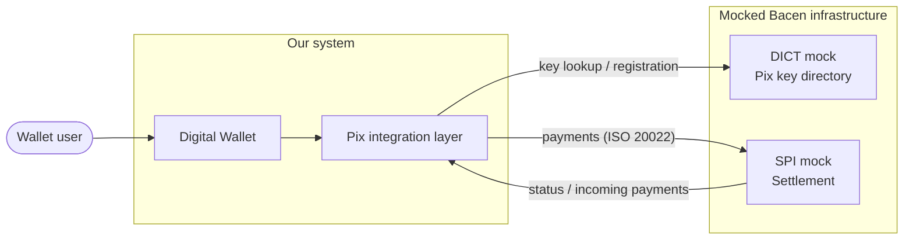

# pix_fake

A digital wallet with Pix integration, built against a **mocked** version of the Central Bank of Brazil (Bacen) Pix infrastructure.

The real Pix ecosystem is only reachable by regulated participants. To develop and test a wallet without that access, this project first builds mocks that simulate the Bacen systems, using the **same message formats and contracts Bacen documents**. The wallet talks to the mocks exactly as it would talk to the real thing, so moving to the real infrastructure later is a configuration change rather than a rewrite.

## Scope

| Phase | Component | Status |
|-------|-----------|--------|
| 1 | **DICT mock**: Pix key directory | Implemented: entries and keys, with seed data ([`mock/dict`](mock/dict/README.md)) |
| 2 | **SPI mock**: instant payment settlement | Planned |
| 3 | Digital wallet + Pix integration layer | Planned |

Mocks are built in this order, DICT first, then SPI. Each mock lives under `mock/` and has its own README. The full plan, with what comes next and what was left out on purpose, is in the [roadmap](docs/roadmap.md).

### What the mocks do **not** do

- No mutual TLS or ICP-Brasil certificate authentication between participants. Requests are accepted as-is.
- No message signing (XML digital signatures on SPI messages).
- No real settlement, reserve accounts or liquidity management on Bacen's side.

Contracts, field names and flows follow the Bacen documentation. Security is intentionally simplified.

The DICT mock also has no rate limiting (it never returns `429`), always returns zeroed anti-fraud statistics, and
identifies the calling institution with an `X-Participant-ISPB` header instead of a certificate. Every deliberate
simplification is listed in [`mock/dict/README.md`](mock/dict/README.md#deliberate-simplifications-and-mock-decisions).

## Getting started

The DICT mock is the only runnable piece so far. It needs Go 1.27.3+ and Docker.

```sh
cd mock/dict
make run    # starts Postgres and the DICT mock on :8080
make seed   # loads the test keys (idempotent, can be repeated)
```

A root `make setup` that starts every mock and loads the test data is planned, so the whole Pix environment is ready
for testing with one command. See [`mock/dict/README.md`](mock/dict/README.md) for the seeded keys and a lookup example.

## Architecture



More diagrams (component view, outbound and inbound transfer flows) are in [docs/architecture.md](docs/architecture.md).

## Mocked systems

### 1. DICT: Directory of Transactional Account Identifiers

**Status: implemented** in [`mock/dict`](mock/dict/README.md), following the Bacen DICT API v2.13.0.

The DICT stores Pix keys and links each key to its owner and transactional account. Participants query it before a payment to resolve who is behind a key.

| Operation | Endpoint (base path `/api/v2`) | Status |
|-----------|--------------------------------|--------|
| Create entry | `POST /entries` | Implemented |
| Get entry | `GET /entries/{Key}` | Implemented |
| Update entry | `PUT /entries/{Key}` | Implemented |
| Delete entry | `POST /entries/{Key}/delete` | Implemented |
| Check keys | `POST /keys/check` | Implemented |
| Claims / portability | `/claims...` | Not implemented: not needed to pay or receive Pix, can be added later |
| Fraud, refunds, reconciliation, statistics | various | Not implemented (full list in the mock README) |

Key types: `CPF`, `CNPJ`, `EMAIL`, `PHONE`, `EVP` (random key, generated by the DICT).

**Transport:** HTTP with **XML** bodies (no TLS), under `/api/v2`, the same base path as the real service, so moving to
the real DICT is a base URL change. Errors use `application/problem+xml`.

**Identifying the institution:** there is no mTLS. Every request carries `X-Participant-ISPB`, which is also used for
simple authorization (only the participant that owns an entry can update or delete it).

**Test data:** `make seed` loads 15 keys across the wallet and two other banks, covering every key type, so lookups
already work for tests.

**Contract (Get entry).** The schemas come from [`mock/dict/docs/openapi.json`](mock/dict/docs/openapi.json).

```
GET /api/v2/entries/{Key}
X-Participant-ISPB: 99000001
PI-RequestingParticipant: 99000001
PI-PayerId: 52998224725            (CPF or CNPJ of the payer)
PI-EndToEndId: E9900000120261111120000000000001
```

```xml
<GetEntryResponse>
    <Signature></Signature>
    <ResponseTime>2026-11-11T20:19:49.107Z</ResponseTime>
    <CorrelationId>b80368a1c5a6f8ee14479feb7480947a</CorrelationId>
    <Entry>
        <Key>+5521999990003</Key>
        <KeyType>PHONE</KeyType>
        <Account>
            <Participant>99000002</Participant>   <!-- ISPB, 8 characters -->
            <Branch>0001</Branch>
            <AccountNumber>00456789</AccountNumber>
            <AccountType>CACC</AccountType>       <!-- CACC | TRAN | SLRY | SVGS | OTHR -->
            <OpeningDate>2020-03-10T03:00:00.000Z</OpeningDate>
        </Account>
        <Owner>
            <Type>NATURAL_PERSON</Type>           <!-- NATURAL_PERSON | LEGAL_PERSON -->
            <TaxIdNumber>39053344705</TaxIdNumber>
            <Name>Carlos Mendes</Name>
        </Owner>
        <CreationDate>2026-11-11T20:00:00.000Z</CreationDate>
        <KeyOwnershipDate>2026-11-11T20:00:00.000Z</KeyOwnershipDate>
    </Entry>
</GetEntryResponse>
```

A key that does not exist returns `404` with a `problem+xml` body. Note that `PI-EndToEndId` is required: the payment
identifier must exist **before** the key lookup, and it is the same one later sent in the `pacs.008`.

A key held by the participant that is asking (`PI-RequestingParticipant`) returns `400`
`EntryCannotBeQueriedForBookTransfer`: payments between customers of the same institution are settled internally and
do not query the DICT. They also do not go through the SPI, but must be reported to Bacen afterwards; see
[Payments inside the same institution](docs/architecture.md#payments-inside-the-same-institution-book-transfer).

### 2. SPI: Instant Payment System

The SPI settles Pix payments in real time between participants. Payments are exchanged as **ISO 20022** XML messages.

Messages to mock:

| Message | Direction | Purpose |
|---------|-----------|---------|
| `pacs.008` | Participant → SPI, SPI → Participant | Credit transfer (the payment order) |
| `pacs.002` | SPI → Participant, Participant → SPI | Payment status report (settled / rejected) |
| `pacs.004` | Participant → SPI | Return of a settled payment (refund) |
| `camt.*` | Both | Cancellation and status queries (later phase) |

**Contract sketch (`pacs.008`, simplified):**

```xml
<Document xmlns="urn:iso:std:iso:20022:tech:xsd:pacs.008.001.08">
  <FIToFICstmrCdtTrf>
    <GrpHdr>
      <MsgId>M12345678202411061200abcdef12345</MsgId>
      <CreDtTm>2024-11-06T12:00:00Z</CreDtTm>
      <NbOfTxs>1</NbOfTxs>
    </GrpHdr>
    <CdtTrfTxInf>
      <PmtId>
        <EndToEndId>E1234567820241106120000000000001</EndToEndId>
      </PmtId>
      <IntrBkSttlmAmt Ccy="BRL">10.00</IntrBkSttlmAmt>
      <Dbtr><Nm>Bob Souza</Nm></Dbtr>
      <DbtrAcct>...</DbtrAcct>
      <DbtrAgt>...</DbtrAgt>      <!-- payer ISPB -->
      <CdtrAgt>...</CdtrAgt>      <!-- receiver ISPB -->
      <Cdtr><Nm>Alice Silva</Nm></Cdtr>
      <CdtrAcct>...</CdtrAcct>
      <RmtInf><Ustrd>Lunch</Ustrd></RmtInf>
    </CdtTrfTxInf>
  </FIToFICstmrCdtTrf>
</Document>
```

`EndToEndId` is the unique payment identifier: `E` + payer ISPB (8) + date/time `yyyyMMddHHmm` (12) + 11 alphanumeric characters = 32 characters.

The `pacs.002` response carries the status of the transaction (for example `ACSC` for settled and `RJCT` for rejected, with a reason code).

## Official references

Bacen documentation is the source of truth for every contract in this project. Links are listed so the mocks can be checked against the originals:

- Pix, Bacen home: https://www.bcb.gov.br/estabilidadefinanceira/pix
- DICT API specification (the version this mock follows is recorded in [`mock/dict/README.md`](mock/dict/README.md)): https://www.bcb.gov.br/content/estabilidadefinanceira/pix/API-DICT.html
- Pix technical specifications and manuals (SPI, message catalog): https://www.bcb.gov.br/estabilidadefinanceira/pix, under "Documentação técnica"
- Bacen Pix API (OpenAPI specs, GitHub): https://github.com/bacen/pix-api
- ISO 20022 message catalog: https://www.iso20022.org/iso-20022-message-definitions

> **Note:** verify the links against the Bacen site, since it reorganizes its documentation pages from time to time. The old `bacen/pix-dict-api` GitHub repository is obsolete: current DICT specifications are published only on the Bacen site. Each mock keeps the specification it was built from under its own `docs/` folder and records the version and the date it was taken.

## Layout

```
pix_fake/
├── README.md
├── docs/
│   ├── architecture.md      # diagrams and flows
│   └── roadmap.md           # plan: phases, status, backlog, open decisions
└── mock/
    ├── dict/                # DICT mock (Go + Postgres), see its README
    └── spi/                 # SPI mock (planned)
```

## License

To be defined.
