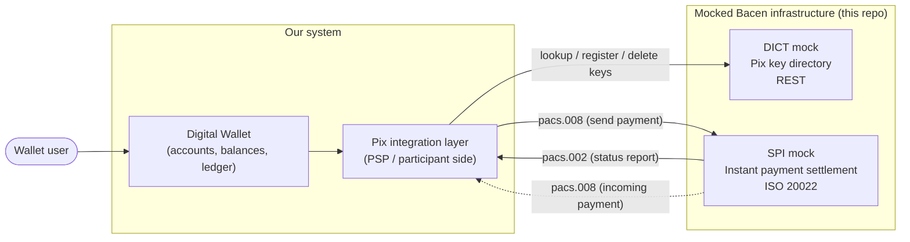
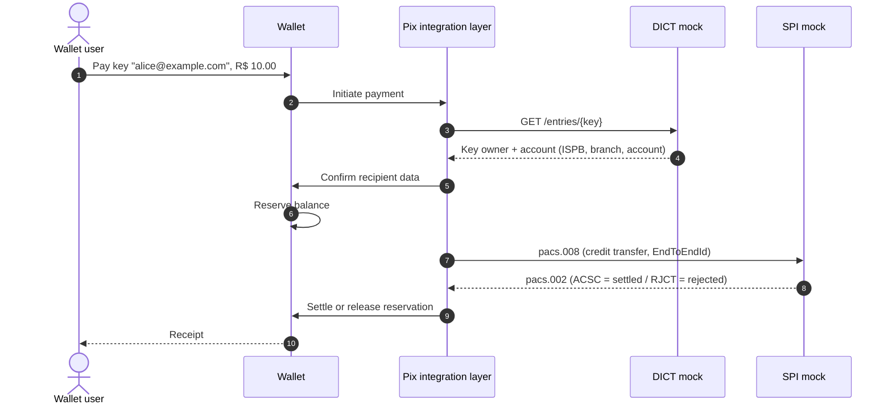
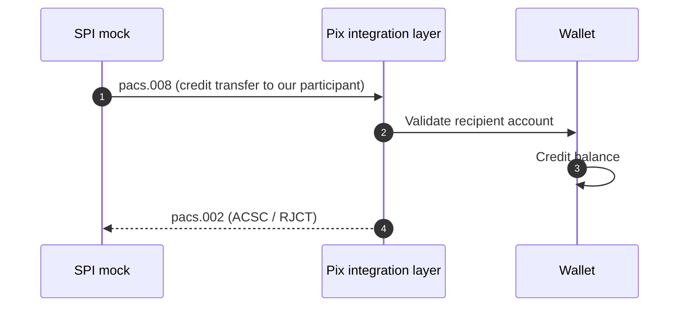

# Architecture

This document describes how the wallet interacts with the **mocked** Central Bank (Bacen) Pix infrastructure.

## Component view

Replacing the mocks with the real DICT and SPI is the long-term goal: the Pix integration layer should only depend on the Bacen contracts, never on mock internals.

## Outbound transfer (wallet user pays a Pix key)

## Inbound transfer (someone pays a wallet user)

