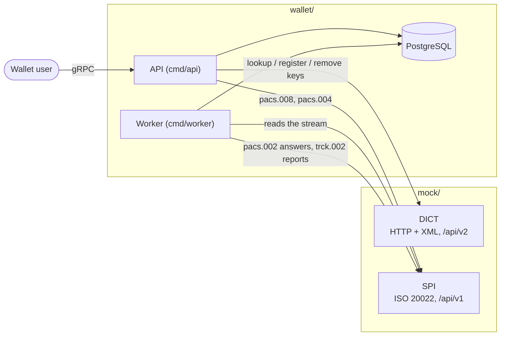
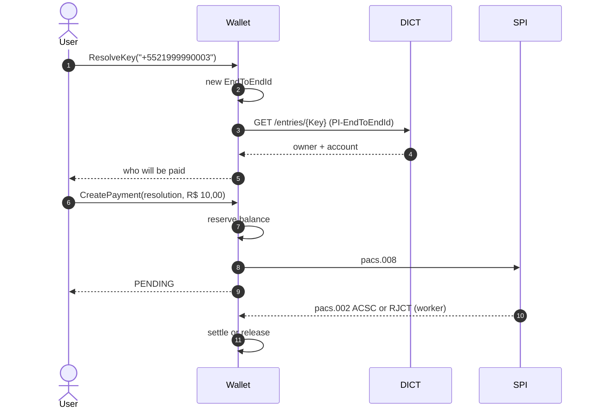
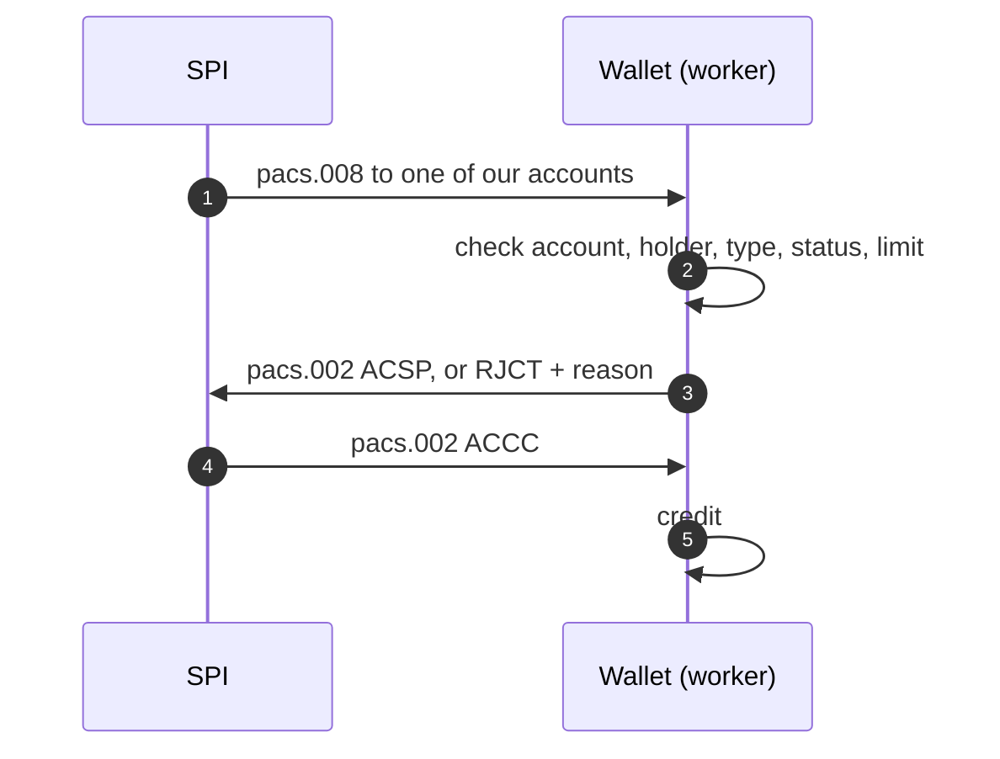
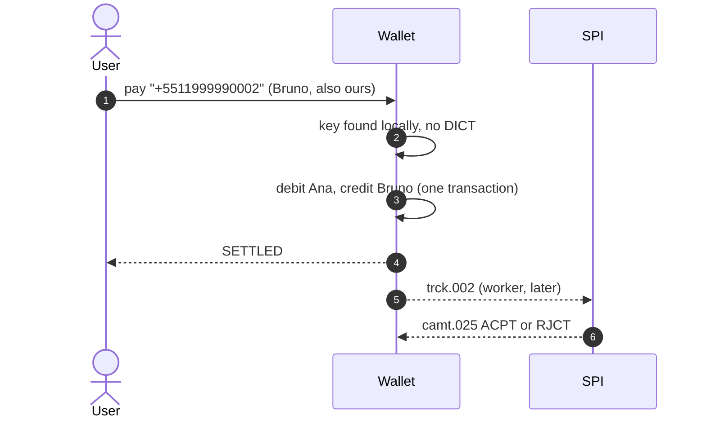

# Architecture

How the wallet talks to the mocked Bacen systems. The wallet depends only on the Bacen contracts, never on mock
internals, so the mocks can be swapped for the real DICT and SPI by changing URLs.

The API handles user calls and sends orders. The worker reads everything the SPI sends (results, incoming payments and
returns, receipts) and runs the periodic jobs. The caller is identified by `X-Participant-ISPB` in the DICT and by the
`{ispb}` in the SPI path; there is no mTLS.

## Paying a key of another bank

The `EndToEndId` is created **before** the lookup: the DICT requires it in `PI-EndToEndId`, and the same value goes in
the `pacs.008`.

If nothing comes back, the SPI itself rejects after 40 s with `AB03`. The wallet never gives up on its own.

## Receiving

The DICT isn't involved: the payer's bank already resolved the key. Money is credited only on `ACCC`, never on `ACSP`.

## Registering a key

`POST /entries` with a `RequestId` (UUID v4) that the wallet creates, so a retry after a timeout doesn't create a second
entry. EVP keys are generated by the DICT. Removing asks the DICT first; a key it no longer has counts as removed.

The wallet keeps its own copy of its keys, so the two can drift apart. `cmd/keys check`, and the worker every 6 hours,
reconcile them the way the DICT API does: a CID per key (HMAC keyed by the registration's `RequestId`), a VSync per key
type compared with `createSyncVerification`, and the DICT's CID file only where they differ. It finds keys missing in
the DICT, keys with other data, and keys only the DICT has.

## Payments inside the same institution (book transfer)

When both sides are wallet customers the rules change:

- **No SPI.** The money moves in the wallet's own ledger, within 40 seconds.
- **No DICT.** The DICT refuses to look up a key held by the asking participant
  (`400 EntryCannotBeQueriedForBookTransfer`), so the wallet finds its own keys in its own records.
- **Reported afterwards**, under art. 2-A of IN BCB 32/2020: a `trck.002` within 30 days of settlement, answered with a
  `camt.025` receipt per transaction. Rejected ones are fixed and sent again.

Sources: Manual de Tempos do Pix 7.0 (1.3, 1.4, 4.5.1), the DICT API v2.13.0 error table, and SPI catalog 5.13
(`trck.002`, `camt.025`). The Instrução Normativa itself wasn't read.
