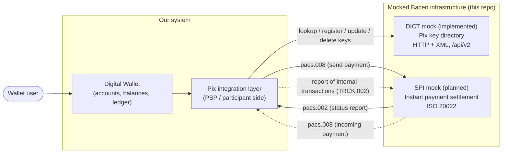
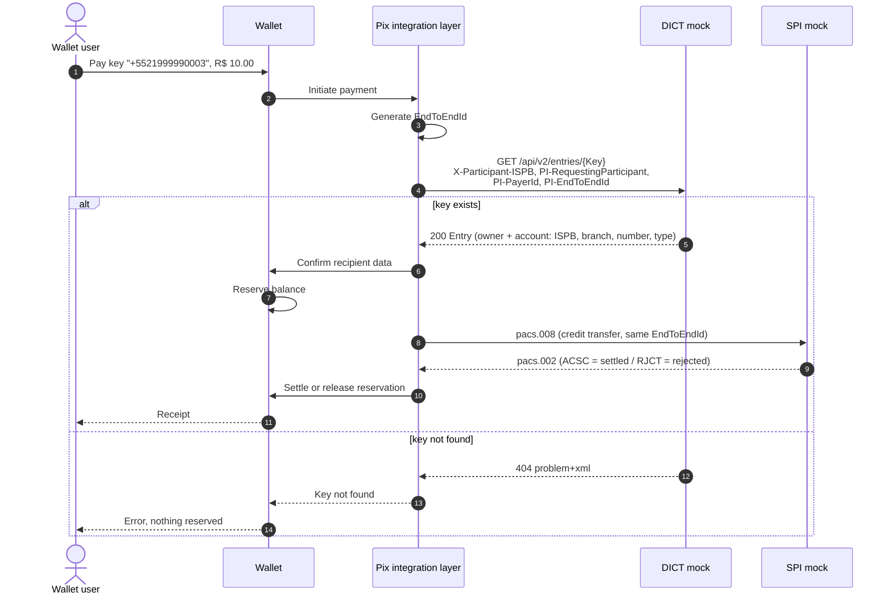
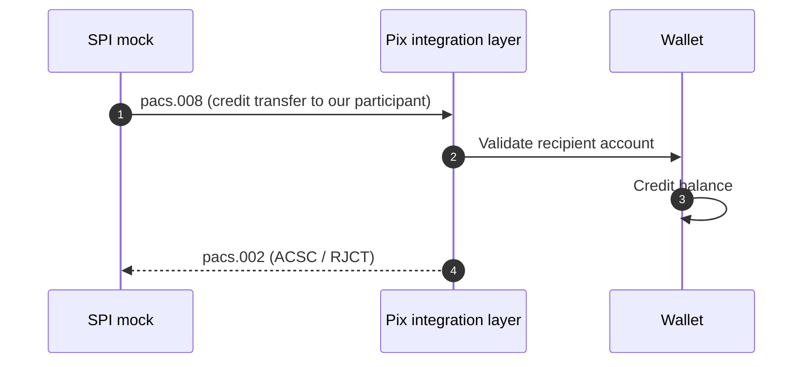
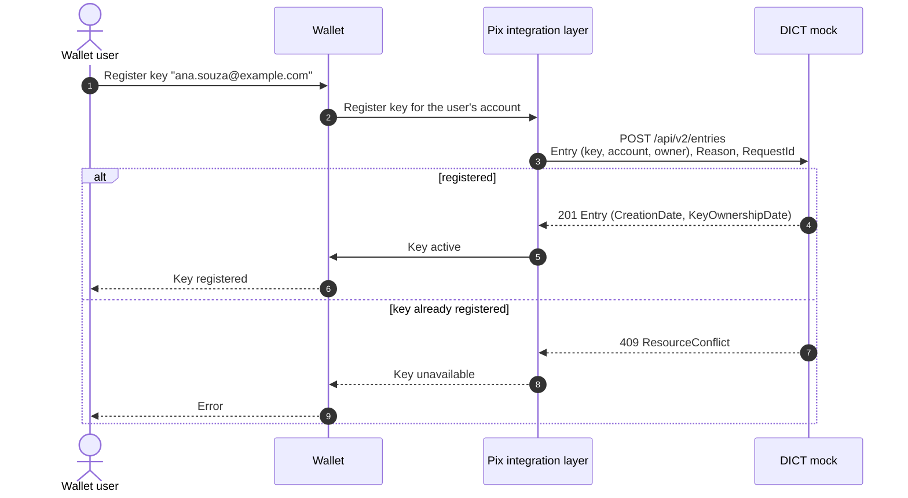
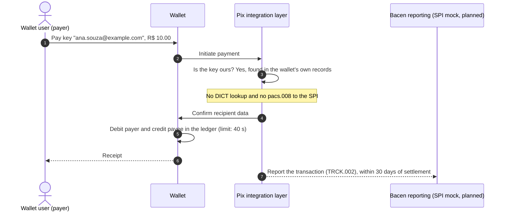

# Architecture

This document describes how the wallet interacts with the **mocked** Central Bank (Bacen) Pix infrastructure.

Status: the **DICT mock** is implemented (see [`mock/dict`](../mock/dict/README.md)). The SPI mock, the Pix integration
layer and the wallet are planned, so the flows below that involve them describe the intended design.

## Component view

Replacing the mocks with the real DICT and SPI is the long-term goal: the Pix integration layer should only depend on the Bacen contracts, never on mock internals. The DICT mock uses the same base path (`/api/v2`) as the real service, so the switch is a base URL change.

### Identifying the institution

The real DICT authenticates participants with mutual TLS. The mock has no certificates: every request carries an `X-Participant-ISPB` header with the caller's ISPB, and the mock uses it for simple authorization (only the participant that owns an entry can update or delete it). The Pix integration layer must send its own ISPB on every DICT request.

### Test data

`make seed` in `mock/dict` loads a fixed set of keys: the wallet's own users (Ana, Bruno and a bakery) and users of two other fictional banks. Every key type is covered, so payments can be tested inside the wallet and across institutions without registering anything first. A root `make setup` that starts every mock and loads this data is planned.

## Outbound transfer (wallet user pays a Pix key)

This is the flow when the payee is a customer of **another** institution. If the key belongs to the wallet itself, the
payment never leaves the institution: see [Payments inside the same institution](#payments-inside-the-same-institution-book-transfer).

The `EndToEndId` is created **before** the key lookup: the DICT requires it in the `PI-EndToEndId` header, and the same value is later sent in the `pacs.008`. Format: `E` + payer ISPB (8) + `yyyyMMddHHmm` (12) + 11 alphanumeric characters = 32 characters.

## Inbound transfer (someone pays a wallet user)

The DICT is not involved in an inbound transfer: the payer's institution already resolved the key.

## Key registration (wallet user registers a Pix key)

Registering is idempotent per `RequestId` (a UUID v4 created by the integration layer), so a retry after a timeout does not create a second entry. For a random key (`EVP`) the request omits `Key` and the DICT returns the generated one.

Removing a key (`POST /api/v2/entries/{Key}/delete`) and updating account or name data (`PUT /api/v2/entries/{Key}`) follow the same shape. Moving a key that is already registered at another institution (claims and portability) is not implemented, because paying and receiving Pix does not need it.

## Payments inside the same institution (book transfer)

When payer and payee are both customers of the wallet, the payment is a *book transfer*. It follows different rules
from an outbound transfer:

- **It is settled outside the SPI.** The wallet moves the money in its own ledger and sends no `pacs.008`. The limit
  to settle is 40 seconds (45 minutes for scheduled Pix); past that it must be rejected.
- **It must not query the DICT.** The DICT refuses it: `GET /entries/{Key}` returns `400`
  `EntryCannotBeQueriedForBookTransfer` when the key is held by the requesting participant. The wallet has to
  recognize its own keys in its own records.
- **It must still be reported to Bacen**, afterwards. Institutions send the transactions settled outside the SPI under
  art. 2-A of Instrução Normativa BCB nº 32/2020, using the `TRCK.002` message from the SPI message catalog. The
  maximum delay to send is 30 days after settlement, and a service-level indicator expects 99% of the messages to be
  created within 300 seconds of the transaction. The channel and the fields of the message are to be confirmed when the
  SPI specification is read (Phase 2).

Sources: Manual de Tempos do Pix, version 7.0 (sections 1.3, 1.4 and 4.5.1), and the DICT API v2.13.0 error table.
I did not read the Instrução Normativa itself or the SPI message catalog, so the exact content of the report is still
open.
