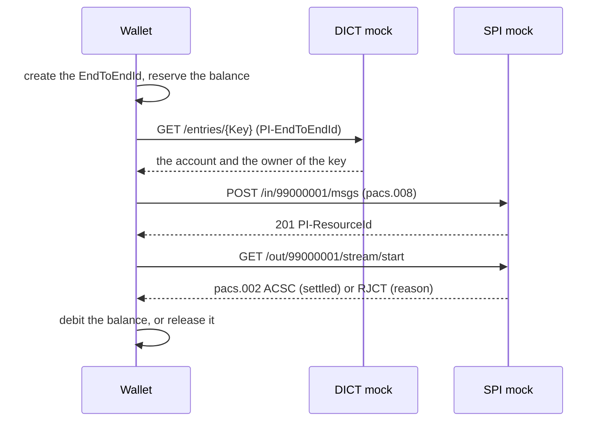
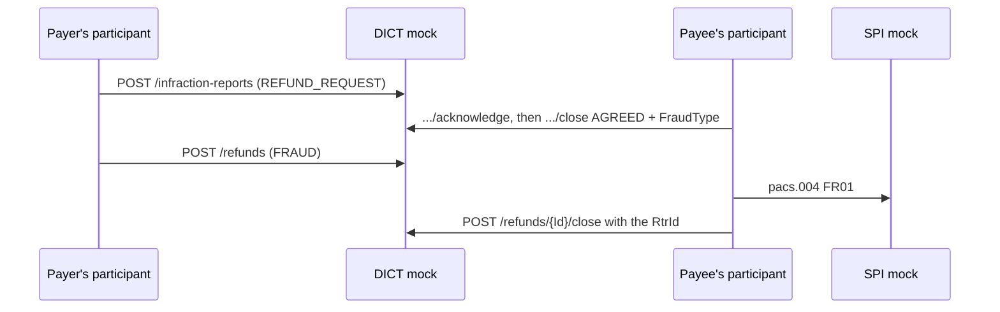

# Integration guide

How to build a Pix participant against the two mocks: the order of the calls, the messages, reading the SPI, and making
the mocks produce the cases you have to handle. Everything here runs against `make setup`.

Contents: [environment](#the-environment) · [identifiers](#identifiers) · [pay a key](#1-pay-a-key-of-another-bank) ·
[receive](#2-receive-a-payment) · [return](#3-return-a-payment) · [inside the wallet](#4-a-payment-between-two-customers-of-yours) ·
[keys](#5-register-and-remove-a-key) · [MED](#6-med-fraud-reports-and-refunds) · [reading the SPI](#reading-what-the-spi-sends) ·
[errors](#errors) · [test data](#test-data) · [control API](#the-control-api) · [differences](#differences-from-the-real-thing)

## The environment

```sh
make setup     # PostgreSQL + both mocks, seeded (needs Docker)
make check     # closing tests against it
make reset     # back to the seed
make logs
make down
```

| | URL | Base path | Specification |
|---|-----|-----------|---------------|
| DICT mock | `http://localhost:8080` | `/api/v2` | DICT API v2.13.0, [`openapi.json`](../mock/dict/docs/openapi.json) |
| SPI mock | `http://localhost:8081` | `/api/v1` | Interfaces manual 1.12 and catalog 5.13, [`mock/spi/docs`](../mock/spi/docs/catalog/README.md) |

No mTLS or signatures: the caller is `X-Participant-ISPB` (plus the spec's `PI-*` headers) in the DICT, and the `{ispb}`
of the path in the SPI.

| ISPB | Institution | Who answers for it |
|------|-------------|--------------------|
| `99000001` | **The wallet** (a placeholder) | **You**: it reads its own messages and answers |
| `99000002` | Banco Alfa | The SPI mock (a simulated bank) |
| `99000003` | Banco Beta | The SPI mock (a simulated bank) |

## Identifiers

| | Format (32 characters) | Example |
|-|------------------------|---------|
| `EndToEndId` | `E` + ISPB of whoever creates it + `yyyyMMddHHmm` UTC + 11 alphanumeric | `E99000001202611141530a1B2c3D4e5F` |
| `RtrId` (a return) | `D` + ISPB + `yyyyMMddHHmm` UTC + 11 alphanumeric | `D99000002202611141535x9Y8z7W6v5U` |
| `MsgId` | `M` + ISPB of the sender + 23 alphanumeric | `M99000001` + 23 characters |

The date inside an `EndToEndId` or `RtrId` must be within 12 hours of the SPI's clock (`FF08` otherwise). The
`EndToEndId` is created **before** the DICT lookup, goes in its `PI-EndToEndId` header and then in the `pacs.008`.

## 1. Pay a key of another bank



**Look the key up.** The headers say who is asking and for which payment:

```sh
curl -s localhost:8080/api/v2/entries/39053344705 \
  -H 'X-Participant-ISPB: 99000001' \
  -H 'PI-RequestingParticipant: 99000001' \
  -H 'PI-PayerId: 52998224725' \
  -H 'PI-EndToEndId: E99000001202611141530a1B2c3D4e5F'
```

Show the owner's name before the user confirms. Unknown key: `404`. Your own key:
`400 EntryCannotBeQueriedForBookTransfer` ([section 4](#4-a-payment-between-two-customers-of-yours)).

**Send the payment**, one `pacs.008`, `Content-Type: application/xml; charset=utf-8`:

```xml
<?xml version="1.0" encoding="UTF-8"?>
<Envelope xmlns="https://www.bcb.gov.br/pi/pacs.008/1.16">
  <AppHdr>
    <Fr><FIId><FinInstnId><Othr><Id>99000001</Id></Othr></FinInstnId></FIId></Fr>
    <To><FIId><FinInstnId><Othr><Id>00038166</Id></Othr></FinInstnId></FIId></To>
    <BizMsgIdr>M99000001abcdefghijklmnopqrstuvw</BizMsgIdr>
    <MsgDefIdr>pacs.008.spi.1.16</MsgDefIdr>
    <CreDt>2026-11-14T15:30:00.000Z</CreDt>
    <Sgntr/>
  </AppHdr>
  <Document>
    <FIToFICstmrCdtTrf>
      <GrpHdr>
        <MsgId>M99000001abcdefghijklmnopqrstuvw</MsgId>
        <CreDtTm>2026-11-14T15:30:00.000Z</CreDtTm>
        <NbOfTxs>1</NbOfTxs>
        <SttlmInf><SttlmMtd>CLRG</SttlmMtd></SttlmInf>
        <PmtTpInf><InstrPrty>HIGH</InstrPrty><SvcLvl><Prtry>PAGPRI</Prtry></SvcLvl></PmtTpInf>
      </GrpHdr>
      <CdtTrfTxInf>
        <PmtId><EndToEndId>E99000001202611141530a1B2c3D4e5F</EndToEndId></PmtId>
        <IntrBkSttlmAmt Ccy="BRL">25.90</IntrBkSttlmAmt>
        <AccptncDtTm>2026-11-14T15:30:00.000Z</AccptncDtTm>
        <ChrgBr>SLEV</ChrgBr>
        <MndtRltdInf><Tp><LclInstrm><Prtry>DICT</Prtry></LclInstrm></Tp></MndtRltdInf>
        <Dbtr><Nm>Ana Souza</Nm><Id><PrvtId><Othr><Id>52998224725</Id></Othr></PrvtId></Id></Dbtr>
        <DbtrAcct><Id><Othr><Id>00123456</Id><Issr>0001</Issr></Othr></Id><Tp><Cd>CACC</Cd></Tp></DbtrAcct>
        <DbtrAgt><FinInstnId><ClrSysMmbId><MmbId>99000001</MmbId></ClrSysMmbId></FinInstnId></DbtrAgt>
        <CdtrAgt><FinInstnId><ClrSysMmbId><MmbId>99000002</MmbId></ClrSysMmbId></FinInstnId></CdtrAgt>
        <Cdtr><Id><PrvtId><Othr><Id>39053344705</Id></Othr></PrvtId></Id></Cdtr>
        <CdtrAcct>
          <Id><Othr><Id>00456789</Id><Issr>0001</Issr></Othr></Id>
          <Tp><Cd>CACC</Cd></Tp>
          <Prxy><Id>39053344705</Id></Prxy>
        </CdtrAcct>
        <Purp><Cd>IPAY</Cd></Purp>
      </CdtTrfTxInf>
    </FIToFICstmrCdtTrf>
  </Document>
</Envelope>
```

`Cdtr*` comes from the DICT answer. With initiation `DICT` the key goes in `Prxy`; a payment by account number is
`MANU`, with no `Prxy`. The `201` only means the SPI stored it.

**Read the result** from your stream ([below](#reading-what-the-spi-sends)): a `pacs.002` about your `EndToEndId`.

| `TxSts` | Meaning | You |
|---------|---------|-----|
| `ACSC` | Settled | Debit the reserved balance, tell the user |
| `RJCT` + a reason | Rejected | Release the reservation, tell the user why ([reasons](#errors)) |

With no answer, the SPI rejects after **40 s** with `AB03`. Keep the reservation until you get an answer; resending the
**same** order is safe for 24 h, a new `EndToEndId` is not.

## 2. Receive a payment

A `pacs.008` for one of your customers arrives on your stream. Make Banco Alfa send one:

```sh
curl -s -X POST localhost:8081/mock/inbound/payments -d '{
  "from": "99000002", "to": "99000001", "to_account": "00123456",
  "amount": "10.50", "key": "ana.souza@example.com" }'
```

Check the account (exists, active, `Cdtr` is its holder) and answer **within 40 s** with a `pacs.002`:

```xml
<TxInfAndSts>
  <OrgnlInstrId>E99000002202611141530a1B2c3D4e5F</OrgnlInstrId>
  <OrgnlEndToEndId>E99000002202611141530a1B2c3D4e5F</OrgnlEndToEndId>
  <TxSts>ACSP</TxSts>            <!-- or RJCT with <StsRsnInf><Rsn><Cd>AC03</Cd></Rsn></StsRsnInf> -->
</TxInfAndSts>
```

Credit only on the `ACCC` that follows, **not** on `ACSP`. Reject with a true reason: `AC03` (no such account), `AC07`
(closed), `AC06` (blocked), `BE01` (not the holder), `AM02` (above the limit), `AG03` (the account doesn't take this),
`DS04` (other), `FRAD` (suspected fraud). All codes: [data contract](../mock/spi/docs/catalog/data-contract.md#reason-codes).

## 3. Return a payment

A return is a `pacs.004` that goes through the same cycle, the other way.

- **Returning one you received:** a new `RtrId`, the payment's `OrgnlEndToEndId`, up to what is left, reason `MD06`
  (or `FR01`/`BE08` for the MED, [section 6](#6-med-fraud-reports-and-refunds)). The answer is a `pacs.002` whose
  `OrgnlInstrId` is your `RtrId`. The SPI rejects after 90 days (`DT05`), a payment that didn't settle (`CH16`) and a
  return of a return (`AG13`).
- **Receiving a return of one you made:** a `pacs.004` arrives on your stream. Check the amount (returns can't add up to
  more than the payment: `AM09`) and answer with a `pacs.002` whose `OrgnlInstrId` is the `RtrId`. Make a bank send one:

```sh
curl -s -X POST localhost:8081/mock/inbound/returns -d '{"end_to_end_id": "E99000001202611141530a1B2c3D4e5F", "amount": "5.00"}'
```

## 4. A payment between two customers of yours

Move the money in your own ledger **within 40 s**, with no DICT and no SPI. The DICT enforces it:

```sh
curl -s -i localhost:8080/api/v2/entries/11144477735 -H 'X-Participant-ISPB: 99000001' \
  -H 'PI-RequestingParticipant: 99000001' -H 'PI-PayerId: 52998224725' -H 'PI-EndToEndId: E99000001202611141530a1B2c3D4e5F'
# HTTP/1.1 400 ... <type>.../error/EntryCannotBeQueriedForBookTransfer</type>
```

Then **report** it within 30 days with a `trck.002` (scenario `BOK1`, the settlement time in `ReqdExctnDt`). Each
transaction gets a `camt.025`: `ACPT`, or `RJCT` with `FF08` (over 30 days), `AM01`, `AG01` (different participants: it
should have gone through the SPI), `ED05`... Fix and resend what is rejected; reporting twice is fine.

## 5. Register and remove a key

- `POST /api/v2/entries` with the account, the owner and a `RequestId` (UUID v4) you create. The same `RequestId` and
  data give the same entry back; other data is `400 RequestIdAlreadyUsed`; a key taken is `409`. For `EVP`, leave `Key`
  out and the DICT generates it.
- `PUT /entries/{Key}` changes the account or name, `POST /entries/{Key}/delete` removes, `POST /keys/check` tells which
  of up to 200 keys exist. Writes come from the participant that holds the key.
- **Reconciliation.** Keep each key's `RequestId`: it keys the key's CID. Per key type, send the XOR of your CIDs to
  `POST /sync-verifications`; on `NOK`, `POST /cids/files` and `GET /cids/files/{Id}` give a `Url` with every CID the DICT
  has for you, `GET /cids/entries/{Cid}` reads one, and `GET /cids/events` lists the changes. The wallet's
  `cmd/keys check` does all of it.

## 6. MED: fraud reports and refunds

The DICT takes reports and refunds only on transactions it knows; the SPI mock tells it of every payment it settles
(`GET localhost:8080/mock/transactions` lists them). Every MED call needs `PI-RequestingParticipant`. The DICT calls no
one: poll its lists (`ModifiedAfter` is inclusive).



**As the payer's participant** (your customer was defrauded):

```xml
<CreateInfractionReportRequest>
  <Participant>99000001</Participant>
  <InfractionReport>
    <TransactionId>E99000001202611141530a1B2c3D4e5F</TransactionId>
    <Reason>REFUND_REQUEST</Reason>
    <SituationType>SCAM</SituationType>        <!-- ACCOUNT_TAKEOVER, COERCION, FRAUDULENT_ACCESS, OTHER -->
    <ReportDetails>Golpe do falso parente</ReportDetails>
  </InfractionReport>
</CreateInfractionReportRequest>
```

One report per transaction can be in progress (`409`). Follow it with `GET /infraction-reports?Participant=...&IsReporter=true`;
when it is `CLOSED` with `AGREED`, ask for the money with `POST /refunds` (`RefundReason` `FRAUD`, up to the amount). The
money comes as a `pacs.004` `FR01` on your stream; the refund is then closed by the other side.

**As the payee's participant** (the money went to your customer): list `IsCounterparty=true`, acknowledge, block the
money, analyse, and close `AGREED` (with a `FraudType`) or `DISAGREED`. An open refund
(`GET /refunds?ParticipantRole=CONTESTED&Status=OPEN`) is answered with a `pacs.004` (`FR01`, or `BE08` for
`OPERATIONAL_FLAW`) and closed with its `RtrId` as `RefundTransactionId`: `TOTALLY_ACCEPTED`, `PARTIALLY_ACCEPTED`, or
`REJECTED` with a reason (`NO_BALANCE`...).

To play the other bank, call the DICT with `X-Participant-ISPB: 99000002`, and have it return in the SPI with
`POST /mock/inbound/returns` and `"reason": "FR01"`. Funds recovery (one request that tracks the money through several
accounts) is in the [DICT README](../mock/dict/README.md#med).

## Reading what the SPI sends

Everything comes from one stream:

```
token = GET /api/v1/out/{ispb}/stream/start      -> 200 with a message, or 204 after a few seconds
loop:
    GET the path in the PI-Pull-Next header of the last answer
    on 200: store the message (PI-ResourceId identifies it), hand it to another worker, read again at once
    on 204: nothing yet, read again
when stopping: DELETE the last PI-Pull-Next path     -> marks what you stored as read
```

- A read waits up to 5 s; loop without sleeping. `Accept: multipart/mixed` gives up to 10 messages per answer; gzip works.
- What you don't close with `DELETE` comes again with the **same `PI-ResourceId`**: dedupe on it.
- `PI-Pull-Next` is opaque. A `410` means it is stale: start over with `stream/start`.

By `MsgDefIdr`: `pacs.002` (the result of what you sent, or the final `ACCC` of what you received), `pacs.008` (a payment
to you), `pacs.004` (a return to you), `camt.025` (report receipts), `admi.002` (the SPI couldn't process a message;
`Ref` is its `PI-ResourceId`).

## Errors

HTTP, both mocks: `application/problem+xml` (RFC 7807), whose `type` ends in the error name.

| Status | Meaning | Do |
|--------|---------|----|
| `400` | Invalid request (see `violations` in the DICT) | Fix it; retrying won't help |
| `403` | Not allowed: unknown participant, or not yours | Check the ISPB and the headers |
| `404` | Not found (DICT) | Tell the user |
| `409` | Already exists (DICT) | Don't retry |
| `410` | Stale stream path (SPI) | Start the stream again |
| `429` | Too many requests | Wait `Retry-After`, back off |
| `503` | Unavailable | Retry after `Retry-After`; keep a payment `PENDING` until you know |

Reasons of a rejected payment (`RJCT`), with what to tell the user ([test data](#test-data) has an account for each):

| Code | By | Meaning | Suggested |
|------|----|---------|-----------|
| `AC03` | Receiver | Account or branch does not exist | "Check the account data" |
| `AC06` / `AC07` | Receiver | Account blocked / closed | "The recipient's account cannot receive" |
| `AC14` | Receiver | Wrong account type | "Check the account type" |
| `AG03` | Receiver | The account doesn't take this payment | "The recipient cannot receive this" |
| `AM02` | Receiver | Above the account's limit | "Amount above what the recipient can receive" |
| `BE01` / `CH11` | Receiver | CPF/CNPJ is not the holder's | "Recipient data do not match" |
| `DS04` | Receiver | Refused, no detail | "The recipient's bank refused" |
| `FRAD` | Receiver | Suspected fraud | "The payment was refused" (don't say why) |
| `ED05` / `AB09` | Receiver | Failure at the receiving bank | Offer to try again later |
| `AB03` | SPI | No answer within 40 s | Offer to try again; it did **not** settle |
| `AG12` | SPI | Same institution on both sides | Should have been a book transfer: a bug |
| `FF08`, `CH16`, `AM01`, `AM18`, `RC09`, `RC10`, `AGNT`, `DT02` | SPI | The order itself is wrong | A bug in your message |

## Test data

The same seed in both mocks (CPF keys):

| Key | Holder, bank | Account | A payment to it |
|-----|--------------|---------|-----------------|
| `39053344705` | Carlos Mendes, Alfa | `00456789` | Settles |
| `16899535009` | Daniela Rocha, Beta | `00567890` | Settles |
| `52998224725` | Ana Souza, **wallet** | `00123456` | (yours) |
| `11144477735` | Bruno Lima, **wallet** | `00234567` | (yours: a book transfer) |
| `24681357928` | Eduardo Teixeira, Alfa | `00900001` | `AC07` (closed) |
| `13579246828` | Fernanda Alves, Alfa | `00900002` | `AC06` (blocked) |
| `86420975310` | Gustavo Pires, Beta | `00900003` | Never answers: `AB03` after 40 s |
| `10293847541` | Helena Moraes, Alfa | `00900004` | `DS04` |
| `56473829164` | Igor Batista, Beta | `00900005` | `FRAD` |
| `91827364564` | Julia Nogueira, Alfa | `00900006` | `AM02` |
| `37281946546` | Kleber Duarte, Beta | `00900007` | `AG03` |
| `64528193728` | Larissa Prado, Alfa | `00900008` | `ED05` |
| `82910476340` | Marcos Vieira, Beta | `00900009` | `AB09` |
| `45197286300` | Natalia Freitas, Alfa | `00900010` | `AC14` |
| `73640812913` | Otavio Ramos, Beta | `00900011` | `CH11` |

A `Cdtr` that is not the account's holder gets `BE01`. Phones, emails and EVPs of each person are in the
[DICT seed](../mock/dict/README.md#seed-data). To try the timeout without waiting 40 s: `SPI_TIMEOUT=3s make setup`.

## The control API

JSON under `/mock` on each mock, not part of Bacen's contract (`SPI_CONTROL=off` / `DICT_CONTROL=off` removes it).

```sh
# Look at the state
curl -s 'localhost:8081/mock/payments?status=PENDING'          # also ?kind=RETURN&participant=99000001
curl -s localhost:8081/mock/payments/E99000001202611141530a1B2c3D4e5F
curl -s 'localhost:8081/mock/messages?participant=99000001&direction=out&limit=5'   # the XML the SPI sent you
curl -s localhost:8081/mock/accounts                            # test accounts and how each answers
curl -s 'localhost:8080/mock/entries?participant=99000001'      # your keys in the DICT
curl -s localhost:8080/mock/transactions                        # the transactions the DICT knows (MED)

# Make a bank send you something
curl -s -X POST localhost:8081/mock/inbound/payments -d '{"from":"99000002","to":"99000001","to_account":"00123456","amount":"10.00"}'
curl -s -X POST localhost:8081/mock/inbound/returns  -d '{"end_to_end_id":"E...","amount":"5.00","reason":"FR01"}'

# Break things: 429/503 (with Retry-After) or a delay, for some requests or until removed
curl -s -X POST localhost:8081/mock/faults -d '{"path_prefix":"/api/v1/in/","status":429,"retry_after":3,"count":2}'
curl -s -X POST localhost:8080/mock/faults -d '{"status":503,"retry_after":2}'
curl -s -X POST localhost:8081/mock/faults -d '{"delay_ms":8000,"count":1}'
curl -s -X DELETE localhost:8081/mock/faults

make reset                                                      # both mocks back to the seed
```

- A fault narrows by `method` and `path_prefix`; `count` limits how many requests it hits. `/mock` and `/healthz` are
  never affected.
- `inbound/payments` also takes `payer_account`, and `to_tax_id`, `to_branch`, `to_type` for an account outside the
  seed; `422` if the SPI refuses the order. `inbound/returns` takes `reason` `MD06` (default), `FR01` or `BE08`.

## Differences from the real thing

- No mTLS, certificates or signatures; `Sgntr` is left empty.
- One port for the primary and secondary channels. Scheduled payments, Pix Saque/Troco, Pix Automático, QR code and NFC
  initiation get `CH16`.
- The SPI settles for every participant on its own (no Conta PI balance, so no `AM04`), processes an order inside the
  request that sent it, and has no rate limit of its own.
- The DICT has no claims. Its MED knows only the payments the SPI mock settled (or that `POST /mock/transactions` adds),
  not returns or internal transactions, and does not check a refund's `RefundTransactionId` against the SPI.
- The DICT checks the `PI-EndToEndId` header against the `EndToEndId` shape, stricter than the spec.

More: [DICT README](../mock/dict/README.md) · [SPI README](../mock/spi/README.md) · [architecture](architecture.md) ·
[roadmap](roadmap.md).
