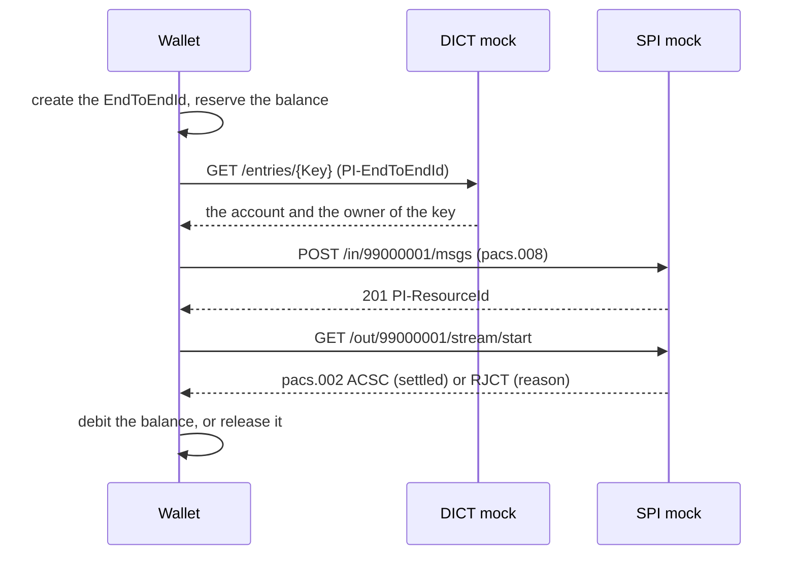

# Integration guide

How to build a Pix participant, such as the wallet, against the DICT mock and the SPI mock. It shows the order of
the calls, the messages, how to read what the SPI sends back, and how to make the mocks produce the situations a
participant has to handle. Everything here was run against the environment that `make setup` starts.

Contents: [the environment](#the-environment) · [identifiers](#identifiers) · [pay a key](#1-pay-a-pix-key-of-another-bank) ·
[receive a payment](#2-receive-a-payment) · [return a payment](#3-return-a-payment) ·
[payment inside the wallet](#4-a-payment-between-two-customers-of-the-wallet) · [register a key](#5-register-and-remove-a-key) ·
[reading the SPI](#reading-what-the-spi-sends) · [errors](#errors-and-what-to-do-with-them) ·
[test data](#test-data) · [control API](#the-control-api) · [differences from the real thing](#differences-from-the-real-thing)

## The environment

```sh
make setup     # builds and starts PostgreSQL and both mocks, with the seed data loaded (needs Docker)
make check     # runs the closing test against it: a quick way to see that everything works
make reset     # puts both mocks back to their seed data
make logs      # follows the logs
make down      # stops everything (the data stays in the volumes)
```

| | URL | Base path | Specification |
|---|-----|-----------|---------------|
| DICT mock | `http://localhost:8080` | `/api/v2` | DICT API v2.13.0, [`openapi.json`](../mock/dict/docs/openapi.json) |
| SPI mock | `http://localhost:8081` | `/api/v1` | Manual das Interfaces 1.12 and message catalog 5.13, see [`mock/spi/docs`](../mock/spi/docs/catalog/README.md) |

The mocks have no mTLS and no signatures. Who is calling is told by a header in the DICT (`X-Participant-ISPB`, plus
the `PI-*` headers of the specification) and by the `{ispb}` in the path in the SPI.

The institutions of the seed:

| ISPB | Institution | Who answers for it |
|------|-------------|--------------------|
| `99000001` | **The wallet** (a placeholder ISPB) | **You.** It reads its own messages and answers |
| `99000002` | Banco Alfa | The SPI mock (a simulated bank) |
| `99000003` | Banco Beta | The SPI mock (a simulated bank) |

## Identifiers

| | Format | Example |
|-|--------|---------|
| ISPB | 8 characters `[0-9A-Z]` | `99000001` |
| `EndToEndId` | `E` + ISPB of whoever creates it (8) + `yyyyMMddHHmm` in UTC (12) + 11 alphanumeric = 32 | `E99000001202611141530a1B2c3D4e5F` |
| `RtrId` (a return) | `D` + ISPB (8) + `yyyyMMddHHmm` UTC (12) + 11 alphanumeric = 32 | `D99000002202611141535x9Y8z7W6v5U` |
| `MsgId` | `M` + ISPB of the sender (8) + 23 alphanumeric = 32 | `M99000001` + 23 characters |

The date inside an `EndToEndId` or `RtrId` must be within 12 hours of the SPI's clock, or the order is rejected with
`FF08`. The `EndToEndId` is created **before** the DICT lookup and goes in the `PI-EndToEndId` header; the same value
goes in the `pacs.008`.

## 1. Pay a Pix key of another bank



**1. Look the key up.** The headers say who is asking and for which payment:

```sh
curl -s localhost:8080/api/v2/entries/39053344705 \
  -H 'X-Participant-ISPB: 99000001' \
  -H 'PI-RequestingParticipant: 99000001' \
  -H 'PI-PayerId: 52998224725' \
  -H 'PI-EndToEndId: E99000001202611141530a1B2c3D4e5F'
```

The answer has the account (`Participant`, `Branch`, `AccountNumber`, `AccountType`) and the owner (`Type`,
`TaxIdNumber`, `Name`). Show the name to your user before they confirm. A key nobody holds is a `404`. A key held by
the participant that is asking is refused with `400 EntryCannotBeQueriedForBookTransfer`: see
[section 4](#4-a-payment-between-two-customers-of-the-wallet).

**2. Send the payment.** One `pacs.008` per payment, `Content-Type: application/xml; charset=utf-8`:

```xml
<?xml version="1.0" encoding="UTF-8"?>
<Envelope xmlns="https://www.bcb.gov.br/pi/pacs.008/1.16">
  <AppHdr>
    <Fr><FIId><FinInstnId><Othr><Id>99000001</Id></Othr></FinInstnId></FIId></Fr>
    <To><FIId><FinInstnId><Othr><Id>00038166</Id></Othr></FinInstnId></FIId></To>
    <BizMsgIdr>M99000001abcdefghijklmnopqrstuvw</BizMsgIdr>
    <MsgDefIdr>pacs.008.spi.1.16</MsgDefIdr>
    <CreDt>2026-11-14T15:30:00.000Z</CreDt>
    <Sgntr/>
  </AppHdr>
  <Document>
    <FIToFICstmrCdtTrf>
      <GrpHdr>
        <MsgId>M99000001abcdefghijklmnopqrstuvw</MsgId>
        <CreDtTm>2026-11-14T15:30:00.000Z</CreDtTm>
        <NbOfTxs>1</NbOfTxs>
        <SttlmInf><SttlmMtd>CLRG</SttlmMtd></SttlmInf>
        <PmtTpInf><InstrPrty>HIGH</InstrPrty><SvcLvl><Prtry>PAGPRI</Prtry></SvcLvl></PmtTpInf>
      </GrpHdr>
      <CdtTrfTxInf>
        <PmtId><EndToEndId>E99000001202611141530a1B2c3D4e5F</EndToEndId></PmtId>
        <IntrBkSttlmAmt Ccy="BRL">25.90</IntrBkSttlmAmt>
        <AccptncDtTm>2026-11-14T15:30:00.000Z</AccptncDtTm>
        <ChrgBr>SLEV</ChrgBr>
        <MndtRltdInf><Tp><LclInstrm><Prtry>DICT</Prtry></LclInstrm></Tp></MndtRltdInf>
        <Dbtr><Nm>Ana Souza</Nm><Id><PrvtId><Othr><Id>52998224725</Id></Othr></PrvtId></Id></Dbtr>
        <DbtrAcct><Id><Othr><Id>00123456</Id><Issr>0001</Issr></Othr></Id><Tp><Cd>CACC</Cd></Tp></DbtrAcct>
        <DbtrAgt><FinInstnId><ClrSysMmbId><MmbId>99000001</MmbId></ClrSysMmbId></FinInstnId></DbtrAgt>
        <CdtrAgt><FinInstnId><ClrSysMmbId><MmbId>99000002</MmbId></ClrSysMmbId></FinInstnId></CdtrAgt>
        <Cdtr><Id><PrvtId><Othr><Id>39053344705</Id></Othr></PrvtId></Id></Cdtr>
        <CdtrAcct>
          <Id><Othr><Id>00456789</Id><Issr>0001</Issr></Othr></Id>
          <Tp><Cd>CACC</Cd></Tp>
          <Prxy><Id>39053344705</Id></Prxy>
        </CdtrAcct>
        <Purp><Cd>IPAY</Cd></Purp>
      </CdtTrfTxInf>
    </FIToFICstmrCdtTrf>
  </Document>
</Envelope>
```

The values in `Cdtr*` and `CdtrAcct` come from the DICT answer. `Prxy` carries the key and goes with the initiation
`DICT`; for a payment typed in by account number the initiation is `MANU` and there is no `Prxy`. The answer is `201`
with a `PI-ResourceId` header. That only means the SPI stored it: the result comes later.

**3. Read the result** from your output stream (see [reading what the SPI sends](#reading-what-the-spi-sends)). You
get a `pacs.002` about your `EndToEndId` (`OrgnlInstrId` and `OrgnlEndToEndId`):

| `TxSts` | Meaning | You |
|---------|---------|-----|
| `ACSC` | Settled | Debit the reserved balance, tell the user |
| `RJCT` + a reason code | Rejected | Release the reservation, tell the user why. [Reasons](#errors-and-what-to-do-with-them) |

If nothing arrives, the SPI rejects the payment itself after **40 seconds** with `RJCT` `AB03`. Keep the reservation
until you get an answer; do not retry with a new `EndToEndId` before one comes. Sending the **same** order again is
safe: for 24 hours the SPI answers it with the outcome it already has.

## 2. Receive a payment

The SPI forwards to you a `pacs.008` addressed to one of your customers. You read it from your stream, check the
account, and answer within 40 seconds.

Make a bank send you one (the control API stands in for Banco Alfa's systems):

```sh
curl -s -X POST localhost:8081/mock/inbound/payments -d '{
  "from": "99000002", "to": "99000001", "to_account": "00123456",
  "amount": "10.50", "key": "ana.souza@example.com" }'
```

The answer shows the payment as `PENDING`. Read it from your stream: it is a `pacs.008` whose `CdtrAgt` is you. Check
that the account exists and is active, that `Cdtr/.../Id` (the CPF/CNPJ) is the account's holder, and answer with a
`pacs.002` to the SPI:

```xml
<TxInfAndSts>
  <OrgnlInstrId>E99000002202611141530a1B2c3D4e5F</OrgnlInstrId>
  <OrgnlEndToEndId>E99000002202611141530a1B2c3D4e5F</OrgnlEndToEndId>
  <TxSts>ACSP</TxSts>            <!-- accept; or RJCT with <StsRsnInf><Rsn><Cd>AC03</Cd></Rsn></StsRsnInf> -->
</TxInfAndSts>
```

Send it like any message (`POST /in/99000001/msgs`, with the usual `AppHdr` and `GrpHdr`). Then wait for a `pacs.002`
with `ACCC`: that is the SPI telling you the payment settled and you can credit the account. Do **not** credit on
`ACSP`.

Reject with a reason that is true: `AC03` (no such account), `AC07` (closed), `AC06` (blocked), `BE01` (the CPF/CNPJ is
not the holder's), `AM02` (above the limit), `AG03` (the account does not take this), `DS04` (any other refusal), `FRAD`
(suspected fraud). The full list is in the [data contract](../mock/spi/docs/catalog/data-contract.md#reason-codes).

## 3. Return a payment

A customer who received a payment can send it back. The receiving participant sends a `pacs.004` to the SPI, which
forwards it to the participant of the original payer, which accepts or rejects it, as in a payment.

**You return a payment you received** (`POST /in/99000001/msgs` with a `pacs.004`): `RtrId` is new, `OrgnlEndToEndId`
is the payment's, the amount can be less than the original (a partial return), the reason is `MD06`, `DbtrAgt` is you
and `CdtrAgt` is the participant of the original payer. The result comes back as a `pacs.002` whose `OrgnlInstrId` is
your `RtrId`: `ACSC` is settled. The SPI rejects a return after 90 days (`DT05`), of a payment that did not settle
(`CH16`), and of a return (`AG13`).

**Someone returns a payment you made** (you are the receiver of the return): you get a `pacs.004` in your stream. Check
the account, the amount (the returns of a payment cannot add up to more than it, `AM09`) and answer with a `pacs.002`
whose `OrgnlInstrId` is the `RtrId` and `OrgnlEndToEndId` is the payment's. Make a bank return one:

```sh
curl -s -X POST localhost:8081/mock/inbound/returns -d '{ "end_to_end_id": "E99000001202611141530a1B2c3D4e5F", "amount": "5.00" }'
```

## 4. A payment between two customers of the wallet

Both customers are yours, so the money moves in your own ledger, **within 40 seconds**, and the payment never goes to the
DICT or the SPI. The DICT enforces it: looking up a key your own participant holds is refused,

```sh
curl -s -i localhost:8080/api/v2/entries/11144477735 -H 'X-Participant-ISPB: 99000001' \
  -H 'PI-RequestingParticipant: 99000001' -H 'PI-PayerId: 52998224725' -H 'PI-EndToEndId: E99000001202611141530a1B2c3D4e5F'
# HTTP/1.1 400 ... <type>.../error/EntryCannotBeQueriedForBookTransfer</type>
```

so recognise your own keys in your own records first. After settling, **report** the transaction to the SPI (within 30
days) with a `trck.002`: the same fields as the payment, scenario `BOK1` (same participant on both sides), the moment it
settled in `ReqdExctnDt`. The SPI answers with a `camt.025`, one receipt per reported transaction:
`ACPT` (recorded) or `RJCT` with `FF08` (older than 30 days), `AM01`, `AG01` (the sides are different participants: it
should have gone through the SPI), `ED05`... A rejected transaction can be fixed and sent again. Reporting twice is
accepted.

## 5. Register and remove a key

`POST /api/v2/entries` with the account, the owner and a `RequestId` (a UUID v4 you create). Retrying with the same
`RequestId` and the same data is safe and returns the same entry; the same `RequestId` with other data is `400
RequestIdAlreadyUsed`. A key that is registered is a `409`. A random key (`EVP`) is created without `Key`: the DICT
generates it and returns it. Remove with `POST /api/v2/entries/{Key}/delete`. `PUT /api/v2/entries/{Key}` changes the
account or the name, and `POST /api/v2/keys/check` tells which of up to 200 keys have an entry. The header
`X-Participant-ISPB` must be the participant that holds the key.

## Reading what the SPI sends

Everything the SPI has for you (payments to credit, results, returns, receipts, error notifications) comes from one
stream, by polling:

```
token = GET /api/v1/out/{ispb}/stream/start      -> 200 with a message, or 204 after a few seconds
loop:
    GET the path in the PI-Pull-Next header of the last answer       (keep it for the next read)
    on 200: store the message (PI-ResourceId identifies it), hand it to another worker, read again at once
    on 204: nothing yet, read again
when stopping: DELETE the last PI-Pull-Next path     -> marks what you stored as read
```

- A read **waits** for a message (5 seconds by default) and answers `204` if none comes, so read in a loop; do not
  sleep between reads.
- Send `Accept: multipart/mixed` to get up to 10 messages per answer, and `Accept-Encoding: gzip`.
- A message you did not close with `DELETE` is delivered again, with the **same `PI-ResourceId`**: use it to drop
  duplicates, and do not process a message twice.
- Do not make assumptions about the `PI-Pull-Next` value; use it as it comes.
- A `410` means the path is too old (you closed a later one): start again with `stream/start`.
- Keep reads short and process elsewhere: while you are slow, messages are delivered again.

What arrives, by `MsgDefIdr`: `pacs.002` (result of a payment or a return you sent, or the final confirmation of one
you received), `pacs.008` (a payment to credit), `pacs.004` (a return to credit), `camt.025` (receipts for a report),
`admi.002` (the SPI could not process a message you sent: `Ref` is the `PI-ResourceId` you were given when you sent it).

## Errors and what to do with them

HTTP, both mocks (`application/problem+xml`, RFC 7807, `type` ends in the error name):

| Status | Meaning | Do |
|--------|---------|----|
| `400` | The request is invalid (see `violations` in the DICT, `type` in the SPI) | Fix it; retrying the same request will not help |
| `403` | Not allowed: the participant is not registered, or the key is not yours | Check the ISPB and the header |
| `404` | The key does not exist (DICT) | Tell the user the key was not found |
| `409` | The key is already registered (DICT) | Do not retry |
| `410` | The stream path is too old (SPI) | Start the stream again |
| `429` | Too many requests | Wait `Retry-After` seconds and try again, with backoff |
| `503` | Unavailable | Try again after `Retry-After`; keep a payment `PENDING` until you know |

The mocks do not limit your rate on their own; [make them](#the-control-api) to test your handling.

Reasons of a rejected payment (`RJCT` in a `pacs.002`), with what to tell the user. A test account for each is in
[test data](#test-data):

| Code | Generated by | Meaning | Suggested |
|------|--------------|---------|-----------|
| `AC03` | Receiver | Account or branch does not exist | "Check the account data" |
| `AC06` | Receiver | Account blocked | "The recipient's account cannot receive" |
| `AC07` | Receiver | Account closed | same |
| `AC14` | Receiver | Wrong account type | "Check the account type" |
| `AG03` | Receiver | The account does not take this payment (such as a salary account) | "The recipient cannot receive this" |
| `AM02` | Receiver | Above the limit of the account | "Amount above what the recipient can receive" |
| `BE01` / `CH11` | Receiver | CPF/CNPJ does not match the holder | "Recipient data do not match" |
| `DS04` | Receiver | Refused, no detail | "The recipient's bank refused" |
| `FRAD` | Receiver | Suspected fraud | "The payment was refused" (do not say why) |
| `ED05` / `AB09` | Receiver | Failure at the receiving bank | Offer to try again later |
| `AB03` | SPI | No answer within 40 s | Offer to try again; the payment did **not** settle |
| `AG12` | SPI | Same institution on both sides | It should have been a book transfer: a bug |
| `FF08`, `CH16`, `AM01`, `AM18`, `RC09`, `RC10`, `AGNT`, `DT02` | SPI | The order itself is wrong | A bug in your message |

## Test data

The seed is the same in both mocks. The keys that matter for trying your flows (all CPF keys unless said):

| Key | Holder | Account | What a payment to it does |
|-----|--------|---------|---------------------------|
| `39053344705` | Carlos Mendes, Banco Alfa | `00456789` | Settles |
| `16899535009` | Daniela Rocha, Banco Beta | `00567890` | Settles |
| `52998224725` | Ana Souza, **wallet** | `00123456` | (the wallet's own) |
| `11144477735` | Bruno Lima, **wallet** | `00234567` | (the wallet's own: a book transfer) |
| `24681357928` | Eduardo Teixeira, Banco Alfa | `00900001` | Rejected `AC07` (closed) |
| `13579246828` | Fernanda Alves, Banco Alfa | `00900002` | Rejected `AC06` (blocked) |
| `86420975310` | Gustavo Pires, Banco Beta | `00900003` | Never answers: `AB03` after 40 s |
| `10293847541` | Helena Moraes, Banco Alfa | `00900004` | Rejected `DS04` |
| `56473829164` | Igor Batista, Banco Beta | `00900005` | Rejected `FRAD` |
| `91827364564` | Julia Nogueira, Banco Alfa | `00900006` | Rejected `AM02` |
| `37281946546` | Kleber Duarte, Banco Beta | `00900007` | Rejected `AG03` |
| `64528193728` | Larissa Prado, Banco Alfa | `00900008` | Rejected `ED05` |
| `82910476340` | Marcos Vieira, Banco Beta | `00900009` | Rejected `AB09` |
| `45197286300` | Natalia Freitas, Banco Alfa | `00900010` | Rejected `AC14` |
| `73640812913` | Otavio Ramos, Banco Beta | `00900011` | Rejected `CH11` |

If the CPF you put in the `pacs.008` is not the holder's (`Cdtr` does not match the account), a normal account answers
`BE01`. Every key in the seed is in the [DICT README](../mock/dict/README.md#seed-data), and `GET /mock/accounts` lists the accounts
of the SPI with how each answers. To try the 40-second timeout without waiting, start the environment with
`SPI_TIMEOUT=3s make setup`.

## The control API

Under `/mock` on each mock, JSON, not part of the Bacen contract (turn it off with `SPI_CONTROL=off` or
`DICT_CONTROL=off`). It is how a test looks at the state, makes a bank send something, and breaks things on purpose.

```sh
# Look at the state
curl -s 'localhost:8081/mock/payments?status=PENDING'          # payments and returns (also ?kind=RETURN&participant=99000001)
curl -s localhost:8081/mock/payments/E99000001202611141530a1B2c3D4e5F
curl -s 'localhost:8081/mock/messages?participant=99000001&direction=out&limit=5'   # the XML the SPI sent you
curl -s localhost:8081/mock/accounts                            # test accounts and how each answers
curl -s 'localhost:8080/mock/entries?participant=99000001'      # the keys your wallet registered

# Make a bank send you something
curl -s -X POST localhost:8081/mock/inbound/payments -d '{"from":"99000002","to":"99000001","to_account":"00123456","amount":"10.00"}'
curl -s -X POST localhost:8081/mock/inbound/returns  -d '{"end_to_end_id":"E...","amount":"5.00"}'

# Break things on purpose: 429/503 (with Retry-After) or a delay, for some requests or until removed
curl -s -X POST localhost:8081/mock/faults -d '{"path_prefix":"/api/v1/in/","status":429,"retry_after":3,"count":2}'
curl -s -X POST localhost:8080/mock/faults -d '{"status":503,"retry_after":2}'
curl -s -X POST localhost:8081/mock/faults -d '{"delay_ms":8000,"count":1}'      # a slow answer, to try your timeout
curl -s localhost:8081/mock/faults ; curl -s -X DELETE localhost:8081/mock/faults    # list; remove all

# Start clean
make reset                                                       # both mocks, back to the seed data
```

A rule can narrow by `method` (`"GET"`) and `path_prefix`, and `count` limits how many requests it affects (without it
the rule stays until you remove it). The control API and the health check are never affected by a rule.
`inbound/payments` takes the payer's account from `payer_account` (default: the first active account of that bank) and,
for an account that is not in the seed, `to_tax_id`, `to_branch` and `to_type`. If the SPI refuses the order, the answer
is `422` with a pointer to the message it queued.

## Differences from the real thing

- No mTLS, certificates or signatures; `Sgntr` is left empty.
- One port for the primary and the secondary channel; scheduled payments, Pix Saque/Troco, Pix Automático, QR code and
  NFC initiation are not supported (such payments get `CH16`).
- The mock settles for every participant on its own: no Conta PI balance (`AM04` never happens) and no rate limits of its
  own.
- The DICT has no claims and the statistics are always zero. It is stricter than the specification in one place: the
  `PI-EndToEndId` header must have the shape of an `EndToEndId`.
- The SPI processes an order inside the request that sent it.

More detail: [DICT README](../mock/dict/README.md) · [SPI README](../mock/spi/README.md) · [architecture](architecture.md) ·
[roadmap](roadmap.md).
