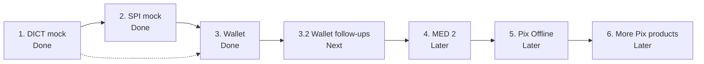

# Roadmap

What comes first and what depends on what. No dates.

| Phase | What | Status |
|-------|------|--------|
| 1 | DICT mock: Pix key directory | Done |
| 2 | SPI mock: instant payment settlement | Done |
| 3 | Wallet and its Pix integration layer | Done |
| 3.2 | Wallet follow-ups: keys check, spec re-check | Next |
| 4 | MED 2: funds recovery | Later |
| 5 | Pix Offline: paying with no internet | Later |
| 6 | More Pix products: BR Code, charges, Pix Automático... | Later |
| - | Environment and quality | Done |

## Principles

- **Follow the Bacen contracts**: same paths, XML, field names and rules, so going live is a base URL change.
- **Follow the inconvenient rules too.** A payment between two customers of the same institution never touches the DICT
  or the SPI, but is reported afterwards ([architecture](architecture.md#payments-inside-the-same-institution-book-transfer)).
- **Security is simplified on purpose**: no mTLS, no XML signatures. The caller is the `X-Participant-ISPB` header (DICT)
  or the `{ispb}` in the path (SPI).
- **Each mock is self-contained** (`mock/<name>/`: Go, `net/http`, PostgreSQL, its own seed) and keeps the spec it was
  built from in its `docs/`, with version and date.
- **Fixed, shared test data**: a key found in the DICT can be paid in the SPI.
- **Tests at three levels**: unit, PostgreSQL, end to end.

## Phase 1: DICT mock (done)

DICT API v2.13.0, see [`mock/dict`](../mock/dict/README.md). `createEntry`, `getEntry`, `updateEntry`, `deleteEntry`,
`checkKeys`; idempotent by `RequestId`; EVP keys generated by the DICT; a lookup of the caller's own key is refused
(`EntryCannotBeQueriedForBookTransfer`). The `PI-EndToEndId` format is checked against the SPI pattern, stricter than the
OpenAPI file.

## Phase 2: SPI mock (done)

See [`mock/spi`](../mock/spi/README.md). Catalog 5.13 (`spi.5.13.2`, checked 2026-11-14).

- Pull model: `POST /in/{ispb}/msgs`, long polling on `/out/{ispb}/stream/start` with `PI-Pull-Next`, `problem+xml`
  errors, gzip, multipart.
- `pacs.008` → `pacs.002` in two phases (receiver answers `ACSP`, SPI sends `ACSC`/`ACCC`). Simulated banks accept or
  reject by creditor account; the 40 s timeout is `AB03`. No liquidity management.
- `pacs.004` returns (90 days, no return of a return, partial allowed, `MD06` only) and `trck.002` reports answered with
  `camt.025`.
- XML is validated by hand in code and checked against the official XSDs in contract tests.
- Closing test: [`e2e/closing_test.go`](../e2e/closing_test.go).

## Phase 3: Wallet (done)

See [`wallet`](../wallet/README.md).

Decisions:

- **Go + gRPC, modular monolith** (`ledger`, `pixkey`, `payment`, `pix`, `grpcapi`) that can be split later: modules
  never touch each other's tables. Two processes: API and worker.
- **Ledger**: balance per account with reservations, not double-entry. Centavos as integers.
- **pgx directly**, no ORM, so the money SQL is explicit (`UPDATE ... WHERE available_cents >= $1`). golang-migrate.
- **Independent of the mocks**: own module, database, compose file and tests. A boundary test fails if it imports a mock
  or hard-codes an endpoint.
- **Paying is two steps** (`ResolveKey`, `CreatePayment`), so the user sees the payee first; the resolution carries the
  `EndToEndId` and makes the payment idempotent. `CreatePayment` doesn't wait for the SPI.
- **No authentication yet.** The ISPB is fictional and comes from `WALLET_ISPB` (default `99000001`).

Built: keys, paying another bank, book transfers (with `trck.002` reports), receiving, returns sent and received, statement,
account status and receive limit, worker sweeps (resend, resume, report, orphaned reservations), and ops commands
(`cmd/accounts`, `cmd/reports`). All tested end to end.

## Environment and quality

- [x] `make setup` / `up` / `down` / `reset`, containers for the mocks
- [x] `make test`, `make test-integration`, `make e2e`, `make coverage`
- [x] CI workflow ([`ci.yml`](../.github/workflows/ci.yml)): lint, tidy, staticcheck, govulncheck (also every Saturday), generated code, unit, PostgreSQL, e2e with a coverage floor of 85%, containers. Runs on GitHub Actions
- [x] Dependabot for the Go modules and the actions, every Saturday
- [x] Contract tests: DICT against `openapi.json`, SPI messages against the XSDs
- [x] Failure simulation (`429`, `503`, slow answers) and a control API in both mocks
- [x] [Integration guide](integration-guide.md)
- [x] Simulator (`make sim`): a web page to drive every situation and follow it to its traces and logs
- [x] Observability: OpenTelemetry in the mocks and the wallet, Grafana with Prometheus, Loki and Tempo in `make up`, a provisioned dashboard

## Phase 3.2: Wallet follow-ups (next)

- [x] Check that the DICT and the wallet's copy of the keys agree: `cmd/keys check`, through `checkKeys`, also run by the
  worker every hour into the gauge `wallet.keys.missing_in_dict` (a panel of the dashboard). It finds keys the wallet has
  and the DICT doesn't; the other direction needs the CID reconciliation, still left out
- [x] Re-check the Bacen specs (2026-11-25): DICT API still v2.13.0 (final of 2026-10-26, the copy in
  `mock/dict/docs`), SPI catalog 5.13 (`spi.5.13.2` still the newest package, the only version in production since
  2026-10-25), Manual das Interfaces de Comunicação 1.12. Nothing to change; re-check at every new version

## Phase 4: MED 2, funds recovery (later)

Fraud handling: the DICT API already defines the areas, and it also reaches the SPI (returns) and the wallet (blocks).

- [ ] Fraud markers, infraction reports
- [ ] Funds recovery: tracking graph, block, refund
- [ ] Event notifications
- [ ] Wallet side: blocks, refund requests, notifications
- [ ] Decide whether it extends `mock/dict` or becomes `mock/med`

## Left out on purpose

| Item | Why |
|------|-----|
| Claims (ownership, portability) | Not needed to pay or receive |
| Reconciliation (CID, `/sync-verifications`) | The mocks have a single source of truth |
| Real anti-fraud statistics | Need SPI data; make sense with MED |
| Rate-limit policies | Failure simulation covers the `429` case |
| Indirect participants | Only direct participants exist |

If claims come back, the first version (removed to keep the mock lean) was: its own service and repository; one open claim
per key via a partial unique index; `confirm` and `complete` each in one transaction; deadlines configurable (7 days by
default); no automatic transitions; visible only to donor and claimer.

## Phase 5: Pix Offline (later)

Paying by proximity when the payer has no internet. It is on the Bacen's agenda for 2026 and 2027, but no spec has been
published yet (checked 2026-11-23), so this phase waits for one, as the [principles](#principles) ask.

- [ ] Get the Bacen spec and keep it in the mock's `docs/`, with version and date
- [ ] Decide whether it extends `mock/spi` or becomes its own mock
- [ ] Wallet side, once the spec says what each participant does

## Phase 6: More Pix products (later)

- [ ] QR codes (BR Code)
- [ ] Pix charges
- [ ] Pix Automático
- [ ] Scheduled payments
- [ ] Pix Saque and Pix Troco

## Open decisions

| Decision | For |
|----------|-----|
| Whether users need claims | Backlog |
| Where MED 2 lives | Phase 4 |
| Where Pix Offline lives | Phase 5 |
