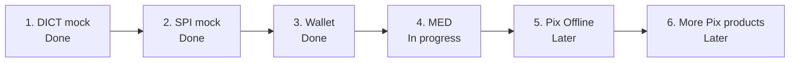

# Roadmap

What comes first and what depends on what. No dates.

| Phase | What | Status |
|-------|------|--------|
| 1 | DICT mock: Pix key directory | Done |
| 2 | SPI mock: instant payment settlement | Done |
| 3 | Wallet, its Pix integration and key reconciliation | Done |
| 4 | MED: infraction reports, refunds, funds recovery | In progress |
| 5 | Pix Offline: paying with no internet | Later (no spec yet) |
| 6 | More Pix products: BR Code, charges, Pix Automático... | Later |

## Principles

- **Follow the Bacen contracts**: same paths, XML, field names and rules, so going live is a base URL change.
- **Follow the inconvenient rules too.** A payment between two customers of the same institution never touches the DICT
  or the SPI, but is reported afterwards ([architecture](architecture.md#payments-inside-the-wallet-book-transfer)).
- **Security is simplified on purpose**: no mTLS, no XML signatures.
- **Each mock is self-contained** (`mock/<name>/`: Go, `net/http`, PostgreSQL, its own seed) and keeps the spec it was
  built from in its `docs/`, with version and date.
- **Fixed, shared test data**: a key found in the DICT can be paid in the SPI.
- **Tests at three levels**: unit, PostgreSQL, end to end.

## Done

**1. DICT mock** ([README](../mock/dict/README.md)), DICT API v2.13.0: entries, `checkKeys`, the reconciliation (CIDs,
sync verifications, CID files and events), and the MED of phase 4.

**2. SPI mock** ([README](../mock/spi/README.md)), catalog 5.13 (`spi.5.13.2`): the pull model with long polling,
`pacs.008`/`pacs.002` in two phases with simulated banks, `pacs.004` returns, `trck.002` reports with `camt.025`
receipts. XML is checked against the official XSDs in contract tests. Closing test:
[`e2e/closing_test.go`](../e2e/closing_test.go).

**3. Wallet** ([README](../wallet/README.md)): keys, paying another bank, book transfers, receiving, returns both ways,
statement, account status and receive limit, the worker's sweeps, ops commands, and the reconciliation of its keys with
the DICT. Decisions:

- **Go + gRPC, modular monolith** (`ledger`, `pixkey`, `payment`, `med`, `pix`, `grpcapi`): modules never touch each
  other's tables, so they can be split later. Two processes: API and worker.
- **Ledger**: a balance per account with reservations, not double-entry. Centavos as integers.
- **pgx, no ORM**, so the money SQL is explicit (`UPDATE ... WHERE available_cents >= $1`). golang-migrate.
- **Independent of the mocks**: own module, database and tests. A boundary test fails if it imports a mock or
  hard-codes an endpoint.
- **Paying is two steps** (`ResolveKey`, `CreatePayment`), so the user sees the payee first; the resolution carries the
  `EndToEndId` and makes the payment idempotent.
- **No authentication yet.** The ISPB is fictional (`WALLET_ISPB`, default `99000001`).

**Environment and quality**: `make up`/`setup`/`e2e`/`coverage`; CI with lint, tidy, staticcheck, govulncheck,
generated code, unit, PostgreSQL and e2e tests (coverage floor 85%); Dependabot; contract tests; faults and a control API
in both mocks; the [integration guide](integration-guide.md); the simulator; OpenTelemetry with Grafana.

The Bacen specs were re-checked on 2026-11-25 (DICT API v2.13.0, SPI catalog 5.13, Interfaces manual 1.12). Re-check at
every new version.

## Phase 4: MED (in progress)

Fraud handling. It extends `mock/dict`, where the DICT API puts it, and reaches the SPI (returns) and the wallet.

- [x] `mock/dict`: infraction reports, fraud markers, refunds, statistics, funds recovery (the `AUTOMATED` flow) and
  event notifications
- [x] `mock/spi`: tells the DICT of every settled payment; MED returns (`pacs.004` `FR01` and `BE08`). Closing test:
  [`e2e/med_test.go`](../e2e/med_test.go)
- [x] Wallet as the payee's participant: acknowledges the reports against its customers, blocks the money, analyses
  them (`cmd/med`) and answers the refunds with a return from the block
- [x] Wallet as the payer's participant: a customer contests a payment (`ContestService`), the wallet reports it, asks for
  the refund when the other bank agrees, and follows it until the money comes back
- [ ] Wallet: funds recovery and its event notifications

## Phase 5: Pix Offline (later)

Paying by proximity when the payer has no internet. It is on the Bacen's agenda for 2026 and 2027, but no spec was
published yet (checked 2026-11-23), so this phase waits for one.

- [ ] Get the spec and keep it in the mock's `docs/`, with version and date
- [ ] Decide whether it extends `mock/spi` or becomes its own mock
- [ ] Wallet side

## Phase 6: More Pix products (later)

- [ ] QR codes (BR Code)
- [ ] Pix charges
- [ ] Pix Automático
- [ ] Scheduled payments
- [ ] Pix Saque and Pix Troco

## Left out on purpose

| Item | Why |
|------|-----|
| Claims (ownership, portability) | Not needed to pay or receive |
| Rate-limit policies | Failure simulation covers the `429` case |
| Indirect participants | Only direct participants exist |

If claims come back, the first version (removed to keep the mock lean) was: its own service and repository, one open
claim per key (a partial unique index), `confirm` and `complete` each in one transaction, deadlines of 7 days by
default, no automatic transitions, visible only to donor and claimer.
