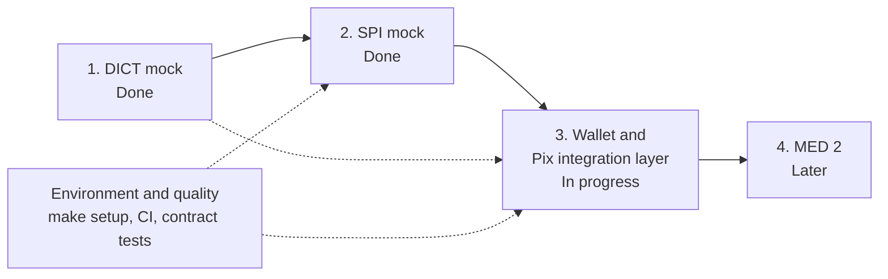

# Roadmap

The plan for the whole project, from the mocked Bacen systems to the wallet. It has **no dates**: it lists what comes
first, what depends on what, and when each piece is considered done.

Statuses: **Done**, **In progress**, **Next**, **Planned**, **Later**, **Idea**. Items marked *(proposed)* are suggestions that have
not been agreed yet. Everything else comes from the project's scope (see the [README](../README.md)).

## Overview

| Phase | Component | Status |
|-------|-----------|--------|
| 1 | DICT mock: Pix key directory | **Done** (entries and keys, seed data) |
| 2 | SPI mock: instant payment settlement | **Done** (payments, returns, reports, rejections, timeout; closing test `make e2e`) |
| 3 | Digital wallet and Pix integration layer | **In progress** (every flow is built; the real-endpoints check is pending) |
| 4 | MED 2: funds recovery | **Later** |
| - | Environment and quality (cross-cutting) | Mostly done: `make setup`, containers, CI workflow, DICT contract tests, failure simulation, control API; specification tracking pending |

## Principles

These decisions apply to every phase:

- **Follow the Bacen contracts.** Same paths, XML formats, field names and validation rules as the official
  specification, so moving to the real infrastructure is a base URL change, not a rewrite.
- **Record the source.** Each mock keeps the specification it was built from under its own `docs/` folder and notes the
  version and the date it was taken in its README.
- **Follow the Bacen rules, including the inconvenient ones.** A payment between two customers of the same institution
  is settled internally: it never queries the DICT and never goes through the SPI, but it is reported to Bacen
  afterwards (see [architecture](architecture.md#payments-inside-the-same-institution-book-transfer)).
- **Security is simplified on purpose.** No mTLS and no XML signatures. The calling institution is identified by the
  `X-Participant-ISPB` header in the DICT and by the `{ispb}` in the URL path in the SPI, as in the real API. Rate limiting is not simulated by default.
- **Each mock is self-contained** under `mock/<name>/`: Go, `net/http` from the standard library, PostgreSQL, its own
  migrations, seed data and README.
- **Test data is fixed and shared.** The seed uses the same fictional institutions across mocks, so a key found in the
  DICT can be paid in the SPI.
- **Three levels of tests:** unit, repository on a real Postgres, and end-to-end over HTTP.
- **Code and documentation are in English.**

## Phase 1: DICT mock (Done)

The Pix key directory, following the Bacen DICT API v2.13.0. See [`mock/dict`](../mock/dict/README.md).

- [x] `createEntry`, `getEntry`, `updateEntry`, `deleteEntry`, `checkKeys`
- [x] Idempotent creation by `RequestId`, random keys (`EVP`) generated by the DICT
- [x] Book transfer rule: a lookup of a key held by the requesting participant is refused with
  `EntryCannotBeQueriedForBookTransfer`, as in the real DICT
- [x] PostgreSQL with embedded migrations
- [x] Seed data: 29 keys across the wallet and two other fictional banks, every key type, including eleven test accounts for the SPI scenarios (`make seed`, idempotent)
- [x] Unit, Postgres repository and end-to-end tests; per-test database schemas so packages run in parallel
- [x] README with the spec version and date, the implemented and pending endpoints, and the mock's simplifications

Small follow-ups:

- [x] Validate the format of `PI-EndToEndId` in the DICT against the SPI pattern, so both sides agree: `E` + ISPB (8) +
  `yyyyMMddHHmm` (12 digits) + 11 alphanumeric characters (32 in total, from the `pacs.008` XSD). The OpenAPI file only
  says "string", so the mock is deliberately stricter here
- [ ] Confirm the wallet's real ISPB (the seed uses the placeholder `99000001`)

## Phase 2: SPI mock (Done)

**Goal:** move money between two participants the way the Bacen SPI does, with the same ISO 20022 messages, so a
payment can be made end to end without the wallet.

### Decided (specification and design)

- [x] **Specification intake.** Interfaces manual 1.12, Fluxos 2.1, Tempos 7.0 and message catalog 5.13 (package
  `spi.5.13.2`) are saved under `mock/spi/docs/` with versions and dates.
- [x] **Delivery model: pull.** Participants send with `POST /api/v1/in/{ispb}/msgs` (`201` plus `PI-ResourceId`, XML,
  up to 10 messages in `multipart/mixed`, gzip) and read with long polling on `GET /api/v1/out/{ispb}/stream/start`,
  following `PI-Pull-Next` (`200` with messages, `204` without) and closing with `DELETE`. Duplicates are identified by
  `ResourceId`. Errors use `application/problem+xml` (RFC 7807). Also `GET /api/v1/in/catalog` and `/out/catalog`.
- [x] **Institution identification.** The `{ispb}` in the path; no `X-Participant-ISPB` header, certificates or
  signatures.
- [x] **Receiving participant.** The mock answers for the simulated banks (Banco Alfa and Banco Beta): it accepts by
  default and rejects according to the creditor account, so tests choose the outcome by choosing whom to pay. The
  wallet is a real participant and answers through its stream. Rules in the
  [SPI README](../mock/spi/README.md#receiving-participant-decision).
- [x] **Channels and time limits.** `PAGPRI` and `PAGFRD` use the primary channel (40 s limit, then the SPI rejects with
  `AB03`); `PAGAGD` uses the secondary channel (45 min). A message on the wrong channel yields an `admi.002`.
- [x] **Settlement model.** Simple: no real reserve accounts or liquidity management.

### Before building

- [x] **Confirm the newest message package** on the Bacen `comunicacaodados` page: `spi.5.13.2` (2026-10-02) is the newest, checked 2026-11-14.
- [x] **Fix the data contract** for `pacs.008` and `pacs.002`, from the catalog XLSX files:
  [`data-contract.md`](../mock/spi/docs/catalog/data-contract.md). `pacs.004`, `trck.002` and `camt.025` have their own sections.
- [x] **XML validation: by hand (decided).** Go has no XSD validator in the standard library, so the mock validates the
  fields it uses in code and checks itself with contract tests against the XSDs and the sample messages in the package,
  instead of binding `libxml2`.

### Build, in order

Each slice works on its own and has tests (unit, repository on a real Postgres, end-to-end over HTTP).

1. [x] **HTTP skeleton and storage.** `POST /api/v1/in/{ispb}/msgs`, the output stream with long polling
   (`PI-Pull-Next`, `200`/`204`, `DELETE`), the catalog endpoints, `problem+xml` errors, gzip, `PI-ResourceId`.
   PostgreSQL with its own migrations. The Postgres repository and end-to-end tests are written but were not run yet (`make test-integration` in `mock/spi`).
2. [x] **`pacs.008` to `pacs.002`, the happy path.** Validate against `pacs.008.spi.1.16`, idempotent by `EndToEndId`.
   Two phases: the SPI forwards the order to the receiver, who answers `ACSP`; the SPI settles and sends `ACSC` to the
   payer's participant and `ACCC` to the receiver's. No balance blocking (no liquidity management). Simulated banks
   accept every order for now; the rules come in step 4.
3. [x] **Seed.** Same institutions and accounts as the DICT seed, plus the test accounts `00900001` to `00900003` and
   their DICT keys, added to both seeds together (`make seed` in each mock; a test fails if the two seeds differ). It
   comes before the rejection rules, which look the accounts up.
4. [x] **Receiving participant rules and rejections.** Creditor-account rules (`AC03`, `AC07`, `AC06`, `BE01`, and a
   silent account), the 40-second timeout (`AB03`, `SPI_TIMEOUT` shortens it), `admi.002` for invalid XML, unsupported
   messages and a malformed `EndToEndId`. The "wrong channel" `admi.002` is not built: the mock has a single channel.
5. [x] **`pacs.004` (return).** `pacs.004.spi.1.5`, same cycle as a payment in the opposite direction. The SPI checks the
   90-day limit (`DT05`), a return of a return (`AG13`) and that the sender received the payment; the participant that
   receives the return checks the amount (`AM09`) and that the account is active. Only reason `MD06`; partial returns
   are allowed.
6. [x] **Report of transactions settled outside the SPI.** Message `trck.002` (`trck.002.spi.1.1`, art. 2-A of
   IN BCB 32/2020, at most 30 days after settlement). The SPI records each transaction and answers with a `camt.025`,
   one receipt per transaction (`ACPT` or `RJCT` with a reason). The real message travels on the secondary channel;
   the mock has a single one.
7. [x] **Closing.** [`e2e/closing_test.go`](../e2e/closing_test.go) plays the wallet and a bank against both running mocks, over
   HTTP and XML only, and covers every point of "Done when" below; `make e2e` starts everything on PostgreSQL and runs it
   (needs Docker). The [SPI README](../mock/spi/README.md#messages) lists the messages implemented and the ones left out.

**Done when:** a script or end-to-end test resolves a seeded key in the DICT, sends a `pacs.008` to the SPI and receives
a settled `pacs.002`; a forced rejection comes back as `RJCT`; a payment can be returned with a `pacs.004`; a report of
an internal transaction is accepted. Query and cancellation messages (`camt.*`) stay for later.

### Still open from Phase 1 (DICT follow-ups)

Listed in Phase 1: confirm the wallet's real ISPB. It does not block the SPI. (The `PI-EndToEndId` pattern is validated.)

## Phase 3: Wallet and Pix integration layer (In progress)

**Goal:** wallet users can register keys, pay, receive and see their history, talking to the mocks only through the
Bacen contracts.

### Decision: the stack of the wallet

- **Go and gRPC.** The public contract is in `wallet/api/proto` (package `wallet.v1`, versioned by package). `make proto`
  in `wallet/` generates the Go code into `wallet/gen`, which is committed so clients can use it. Toward Bacen the wallet
  still speaks HTTP and XML, as the contracts require; gRPC is only the wallet's own API.
- **Modular monolith, to be split into microservices later.** Modules under `wallet/internal`: `ledger` (accounts, balances),
  `payment` (flows and status), `pix` (the integration layer, Bacen clients only), `pixkey` (the wallet's keys), with `grpcapi` as the adapter. A module uses another only through its
  exported API and never its tables, which is what makes the later split possible.
- **Two processes from the same module:** the gRPC API (`cmd/api`) and the worker (`cmd/worker`), started next to each
  other. The worker consumes the SPI output stream and handles timeouts and retries.
- **Ledger:** a simple balance per account with reservation, not double-entry. Money is an integer number of centavos.
- **No authentication for now.** Calls to the API are accepted as they come; revisit before anything leaves local development.
- **ISPB:** keeps the placeholder `99000001` (the same as the mocks' seed) until the real one is known.
- **Database access: pgx, used directly** (`pgxpool`, no ORM and no code generator), so the SQL of the ledger is explicit, for
  example the conditional `UPDATE ... WHERE available_cents >= $1` that makes reserving safe. Transactions go through a
  helper in `platform/db` (`InTx`, over `pgx.BeginTxFunc`), so modules do not handle `pgx.Tx` lifecycle.
- **Migrations: golang-migrate,** SQL files in `wallet/migrations` embedded in the binary. The API and the seed command apply them at start.
- **Contract: three services, one per module** (`wallet/api/proto/wallet/v1`): `AccountService` (balance, statement),
  `KeyService` (register, list, remove) and `PaymentService` (resolve a key, pay, get, list, return). Decisions:
  - **Paying takes two steps**, so the user sees who is paid before confirming: `ResolveKey` looks the key up (in the DICT,
    or in the wallet's records for a book transfer) and returns a `resolution_id`; `CreatePayment` uses it. The
    `resolution_id` carries the `EndToEndId` created before the lookup and makes the payment idempotent: one resolution,
    at most one payment.
  - **`CreatePayment` does not wait for the SPI.** A payment through the SPI returns `PENDING` and the client reads it
    with `GetPayment` or `ListPayments`; a book transfer returns `SETTLED`. Pushing status changes (a streaming call) is left
    for later.
  - **The statement and the payment list are different things.** The statement (`GetStatement`) is money that moved,
    read from the ledger log; `ListPayments` is every payment with its status, including the ones in flight and the rejected.
  - **A return is a payment** of type `RETURN` with the id of the payment it returns; a received payment shows how much was
    already returned.
  - **Idempotency keys are chosen by the client** (`request_id`, `resolution_id`) and errors are gRPC status codes.
  - The whole contract is built: `AccountService` (`GetBalance`, `GetStatement`), `KeyService` and `PaymentService`.
- **Not decided yet:** the HTTP/XML client for Bacen beyond the DICT and SPI clients already built (`internal/pix`).

### Decision: the wallet is independent of the mocks

The wallet is the project's real challenge and the mocks are auxiliary, so it lives in this repository next to
`mock/` but shares nothing with them. See [`wallet/README.md`](../wallet/README.md).

- **Code:** a module of its own under `wallet/`. It never imports, copies or reads code from `mock/`; it talks to the
  mocks over HTTP and XML only. This is what keeps "switching to real endpoints is configuration only" true.
- **Data:** its own PostgreSQL (`:5434`, volume `wallet-pgdata`), migrations and seed. No connection to the databases of
  the mocks, in either direction.
- **Infrastructure:** `wallet/docker-compose.yml` (project `pixwallet`) and `wallet/Makefile`. The root `make setup`
  keeps starting only the mocks, and resetting one side never touches the other.
- **Tests:** the wallet's unit, repository and end-to-end tests live under `wallet/`. The root `e2e/` stays the closing
  test of the mocks.
- **Configuration:** the mocks' URLs and the wallet's ISPB come from environment variables (`wallet/.env.example`).
- **Why here and not in another repository:** one place for the documentation, the roadmap, `make setup` for the mocks
  and a single CI, without publishing images or versioning the mocks separately. The independence above keeps the option
  of moving `wallet/` to its own repository later at a low cost.

- [x] **Repository layout: decided.** `wallet/` next to `mock/` in this repository, fully independent of the mocks
  (see the [decision](#decision-the-wallet-is-independent-of-the-mocks)). Base created: its own PostgreSQL, compose file and Makefile.
- [x] **Stack: decided.** Go, gRPC, modular monolith, simple balance with reservation (see the
  [decisions](#decision-the-stack-of-the-wallet)). Base built: module, gRPC contract with `make proto`, the API and the worker as
  two processes, the empty modules.
- [x] **Wallet core:** accounts, balances and a ledger, with balance reservation while a payment is in flight. Module
  `wallet/internal/ledger`: open an account, credit (idempotent by reference), reserve (idempotent and atomic, refuses an
  overdraft), settle and release, plus an append-only log of every movement. Tested on PostgreSQL, including concurrent
  reservations. `GetBalance` is the first gRPC call. The statement, which reads the log, comes with the features.
- [ ] **Pix integration layer (participant side):**
  - [x] DICT client for the five implemented operations (`wallet/internal/pix`: `GetEntry`, `CreateEntry`, `UpdateEntry`,
    `DeleteEntry`, `CheckKeys`). Tested against a fake server and against the running mock (`WALLET_TEST_DICT_URL`, needs `make setup`)
  - [x] SPI client, first part (`wallet/internal/pix`): send messages, read and acknowledge the stream, build `pacs.008` and
    `pacs.002`, read `pacs.008`, `pacs.002` and `admi.002`. Tested against a fake server and against the running mock (`WALLET_TEST_SPI_URL`)
  - [x] SPI client, second part (`wallet/internal/pix`): returns (`NewPacs004`, `ParsePacs004`, `NewReturnID`) and the report of
    transactions settled outside the SPI (`NewTrck002`, `ParseCamt025`). Checked against the official XSDs (apart from the empty
    `Sgntr`, as in the mock) and against the running mock (`WALLET_TEST_SPI_URL`): a received payment is returned and settled, and a book transfer is reported and accepted
  - [x] `EndToEndId` generation before the key lookup, and `RequestId` (UUID v4) for idempotent registration
  - [x] Mapping of Bacen errors to wallet behavior. DICT: `404`, `409`, `429`, `503` (`errors.Is` with `ErrNotFound`, `ErrConflict`,
    `ErrBookTransfer`, `ErrRateLimited`, `ErrUnavailable`...; `pix.Retryable`). SPI: the reason codes of rejected payments, returns and
    reports (`pacs.002`, `camt.025`, `admi.002`) become a `Rejection` with a cause, `TryAgain`, a message safe for the customer and
    `Alert()` (`ReasonOf`, `wallet/internal/pix/spi_reasons.go`)
- [x] **Proto contract for keys, payments and the statement** (`account.proto`, `key.proto`, `payment.proto`).
- [ ] **Features:**
  - [x] Register and remove a Pix key (module `pixkey`: `RegisterKey`, `ListKeys`, `RemoveKey`). Registering validates, registers in
    the DICT with the client's `request_id` and stores the wallet's own copy; removing asks the DICT first and counts a key it no
    longer has as removed, so every call can be repeated after a failure. Tested on PostgreSQL and end to end through gRPC (`make e2e`,
    [`wallet/e2e`](../wallet/e2e/keys_test.go)): the key shows up in the DICT for another bank, repeating a call is safe, and the
    DICT failing (`503`, `429`) leaves nothing half done.
    Not built: a check that finds keys the DICT and the wallet's copy disagree on
  - [x] Pay a key of another institution (outbound flow). Module `payment`: `ResolveKey` creates the `EndToEndId` and looks the key up;
    `CreatePayment` reserves the money and sends the `pacs.008`, idempotent per resolution (one resolution, at most one payment); the
    worker (`cmd/worker`) reads the SPI stream and settles (`ACSC`) or rejects (`RJCT`, `admi.002`, with the reason of `ReasonOf`) and
    sends again what the SPI did not take while it was down. The 40-second timeout is the SPI's (`AB03`): the wallet never rejects a
    payment the SPI may have taken. Tested on PostgreSQL and end to end (`make e2e`, [`wallet/e2e`](../wallet/e2e/payments_test.go)):
    settled, the seven rejections the SPI mock can force, and the SPI down.
    A crash between reserving and storing the payment is covered by the worker: `ReleaseOrphans` gives back, after 10 minutes (more
    than a resolution lives), a reservation no payment points to; a call that reuses a released reservation is refused
  - [x] Pay a key of another wallet user (book transfer). `ResolveKey` recognizes the wallet's own keys from its own records
    (`pixkey.AccountOf`, loaded by the seed) and never asks the DICT; `CreatePayment` moves the money in one transaction
    (`ledger.Transfer`, idempotent by `EndToEndId`), records the payment each side sees (a sent and a received payment with the same
    `EndToEndId`) and settles in the same call. The worker finishes a transfer that stopped halfway and reports each one to the SPI
    (`trck.002`, scenario `BOK1`), applying the `camt.025`: accepted, sent again after a minute without a receipt, sent again on a
    processing error, final and logged otherwise. Tested on PostgreSQL and end to end (`make e2e`): settled at once, nothing in the
    SPI's payments, the report arrives, refused without funds.
    Known gaps: the 40 seconds are met by settling in the same call, not enforced by a clock; a refused report is only logged, there is
    no way to fix and resend it by hand yet
  - [x] Receive a payment (inbound flow). The worker answers each `pacs.008` the SPI sends: the account is found by branch and number
    (`ledger.AccountByNumber`), and `AC03`, `BE01` or `AC14` are answered with `RJCT` and nothing recorded; an accepted order is
    recorded as an `INBOUND` payment, pending, and answered `ACSP`; `ACCC` credits the account (idempotent by `EndToEndId`) and settles
    it, `RJCT` from the SPI rejects it. Delivered again, it is answered again and recorded once; an answer that cannot be sent leaves
    the batch unacknowledged, so it is retried. Tested on PostgreSQL and end to end (`make e2e`, a simulated bank pays through the
    SPI mock's control API): credited, and refused with each of the three reasons.
    Known gaps: no account status or limits, so `AC06`, `AC07` and `AM02` are never answered
  - [x] Return a received payment (`ReturnPayment`). Only a payment received through the SPI, settled, at most 90 days old, up to
    what is left (`returned_cents`, which counts returns in flight so a rejected one frees its amount). The amount is reserved, a
    `pacs.004` is sent (`MD06`), and `ACSC` or `RJCT` from the SPI settles or releases it. Idempotent by `request_id`; two returns at
    once are serialized on the original payment so they never exceed it. A return's `end_to_end_id` is its `RtrId`. Tested on
    PostgreSQL and end to end (`make e2e`): partial returns until nothing is left, and the refusals.
  - [x] Returns received (`pacs.004`): the bank that got a payment of the wallet gives money back. Answered `ACSP`, recorded as an
    inbound `RETURN`, and credited on `ACCC` with the `RtrId` as reference (idempotent); refused with `DS04` or `AM09`. Tested on
    PostgreSQL and end to end with the SPI mock's `inbound/returns`
  - [x] Statement and payment history. `GetStatement` lists the money that moved (`ledger.Movements`: `CREDIT`, `DEBIT` and `SETTLE`,
    not `RESERVE` or `RELEASE`), paged by the ledger entry id, each entry joined in the `payment` module with its payment and
    counterparty by the movement's reference; a deposit has neither. `ListPayments` is the history with status. Tested on PostgreSQL,
    including that the entries add up to the balance, and end to end
- [ ] **Status tracking:** payments move from pending to settled or rejected, including timeouts and retries. Done for the outbound flow,
  the book transfer, received payments, and returns sent and received (see above).
- [ ] **Switching to real endpoints is configuration only,** checked by tests that fail if the integration layer depends
  on mock internals.

**Done when:** the flows in [architecture.md](architecture.md) work end to end against the seeded institutions: pay a
key of another bank, pay a key of another wallet user without touching the DICT or the SPI, receive from another bank,
register and remove a key.

## Environment and quality (cross-cutting)

Can start before Phase 3 and grows with each mock.

- [x] **Root `make test` and `make e2e`.** `make test` runs the tests of both mocks and the wallet; `make e2e` runs the closing test of the mocks and the wallet's end-to-end tests (`wallet/e2e`, the real API on a throwaway schema), on
  PostgreSQL ([`scripts/e2e.sh`](../scripts/e2e.sh)).
- [x] **Root `make setup`.** One command that builds and starts PostgreSQL and both mocks, with the migrations applied and the
  seed data loaded ([`docker-compose.yml`](../docker-compose.yml)); also `down`, `reset`, `logs`, `status` and `check` (the
  closing test against the running environment).
- [x] **Containers for the mocks.** A `Dockerfile` per mock (multi-stage, runs as a normal user, seeds at start) and the
  root compose file. The compose files inside each mock remain, for `make run` there; they share ports with the root one.
- [x] **Continuous integration.** [`.github/workflows/ci.yml`](../.github/workflows/ci.yml): lint, unit tests, tests on
  PostgreSQL, the closing test and the containers, each one a `make` target. *Written but not run on GitHub yet: the same
  targets were run locally.*
- [x] **Contract tests.** The DICT mock is checked against `openapi.json` (examples, requests and answers, status codes);
  the SPI mock writes every message it produces against the official XSDs. See the READMEs.
- [x] **Failure simulation.** `429`, `503` and slow answers on demand in both mocks, through the control API.
- [x] **Control API and test accounts.** Make a simulated bank pay or return to the participant, look at payments and
  messages, clear the state; eleven test accounts that are closed, blocked, never answer or reject with a given reason.
- [x] **Integration guide.** [`integration-guide.md`](integration-guide.md): the flows, messages, reading the SPI, errors, test data.
- [ ] **Specification tracking** *(proposed)*: re-check the Bacen specifications from time to time and record version
  and date when a mock is updated. (The SPI package and the DICT file were checked on 2026-11-14.)

## Phase 4: MED 2, funds recovery (Later)

**Goal:** support the funds recovery flow for fraud. The DICT API v2.13.0 already defines the areas involved, and the
flow also reaches the SPI (returns) and the wallet (balance blocks).

- [ ] Fraud markers
- [ ] Infraction reports
- [ ] Funds recovery: tracking graph, block, refund
- [ ] Refunds
- [ ] Event notifications
- [ ] Wallet side: handle blocks, refund requests and notifications
- [ ] Decide whether this extends `mock/dict` or lives in a separate mock such as `mock/med`

This phase needs the SPI and the wallet to exist first.

## Deferred backlog

Parts of the specification that were left out on purpose, with the reason.

| Item | Why it is not needed now |
|------|--------------------------|
| **Claims** (ownership and portability): `/claims` endpoints | Paying and receiving Pix does not need them. They only matter if users must bring a key from another bank or reclaim a phone number. |
| **Reconciliation (CID):** `/sync-verifications`, `/cids/...` | Keeps a participant's database consistent with the DICT. The mocks have a single source of truth. |
| **Real anti-fraud statistics** | Counters are always zero. Real values need SPI data and make sense with MED. |
| **Rate-limit policies and buckets:** `/policies`, `429` | Not needed for correctness. See *failure simulation* above for a lighter option. |
| **Indirect participants** | The mocks only have direct participants. |

If claims come back, the first implementation was designed like this (it was removed to keep the mock lean, so these
notes are the only record):

- Separate service and repository from the entries, so the entry rules stay untouched.
- One claim in progress per key, enforced by a partial unique index.
- `confirm` removes the donor's entry and `complete` creates the claimer's, each in a single transaction.
- Deadlines (`ResolutionPeriodEnd`, `CompletionPeriodEnd`) configurable by environment variables, 7 days by default and
  counted from creation, so deadline paths can be tested without waiting.
- No automatic status changes: a claim only moves through API calls.
- Only the donor and the claimer can see a claim.

## Ideas (not planned)

Listed so they are not forgotten. None is agreed.

- Payment by QR code (BR Code, static and dynamic)
- Pix charges (the Bacen Pix API) and Pix Automático
- Scheduled payments
- Pix Saque and Pix Troco

## Open decisions

| Decision | Needed for |
|----------|------------|
| The wallet's real ISPB (the placeholder `99000001` stays for now) | Seed data, wallet configuration |
| Whether users need portability, that is, claims | Backlog |
| Where MED 2 lives: inside `mock/dict` or as a separate mock | Phase 4 |
| Where continuous integration runs | Environment and quality |
