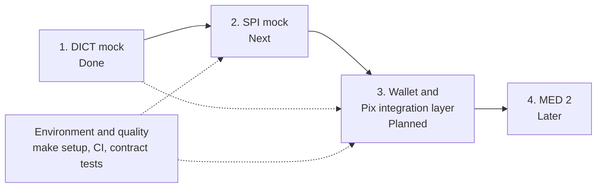

# Roadmap

The plan for the whole project, from the mocked Bacen systems to the wallet. It has **no dates**: it lists what comes
first, what depends on what, and when each piece is considered done.

Statuses: **Done**, **Next**, **Planned**, **Later**, **Idea**. Items marked *(proposed)* are suggestions that have
not been agreed yet. Everything else comes from the project's scope (see the [README](../README.md)).

## Overview

| Phase | Component | Status |
|-------|-----------|--------|
| 1 | DICT mock: Pix key directory | **Done** (entries and keys, seed data) |
| 2 | SPI mock: instant payment settlement | **Next** |
| 3 | Digital wallet and Pix integration layer | **Planned** |
| 4 | MED 2: funds recovery | **Later** |
| - | Environment and quality (cross-cutting) | In progress: seed done, `make setup` pending |

## Principles

These decisions apply to every phase:

- **Follow the Bacen contracts.** Same paths, XML formats, field names and validation rules as the official
  specification, so moving to the real infrastructure is a base URL change, not a rewrite.
- **Record the source.** Each mock keeps the specification it was built from under its own `docs/` folder and notes the
  version and the date it was taken in its README.
- **Follow the Bacen rules, including the inconvenient ones.** A payment between two customers of the same institution
  is settled internally: it never queries the DICT and never goes through the SPI, but it is reported to Bacen
  afterwards (see [architecture](architecture.md#payments-inside-the-same-institution-book-transfer)).
- **Security is simplified on purpose.** No mTLS and no XML signatures. The calling institution is identified by the
  `X-Participant-ISPB` header. Rate limiting is not simulated by default.
- **Each mock is self-contained** under `mock/<name>/`: Go, `net/http` from the standard library, PostgreSQL, its own
  migrations, seed data and README.
- **Test data is fixed and shared.** The seed uses the same fictional institutions across mocks, so a key found in the
  DICT can be paid in the SPI.
- **Three levels of tests:** unit, repository on a real Postgres, and end-to-end over HTTP.
- **Code and documentation are in English.**

## Phase 1: DICT mock (Done)

The Pix key directory, following the Bacen DICT API v2.13.0. See [`mock/dict`](../mock/dict/README.md).

- [x] `createEntry`, `getEntry`, `updateEntry`, `deleteEntry`, `checkKeys`
- [x] Idempotent creation by `RequestId`, random keys (`EVP`) generated by the DICT
- [x] Book transfer rule: a lookup of a key held by the requesting participant is refused with
  `EntryCannotBeQueriedForBookTransfer`, as in the real DICT
- [x] PostgreSQL with embedded migrations
- [x] Seed data: 15 keys across the wallet and two other fictional banks, every key type (`make seed`, idempotent)
- [x] Unit, Postgres repository and end-to-end tests; per-test database schemas so packages run in parallel
- [x] README with the spec version and date, the implemented and pending endpoints, and the mock's simplifications

Small follow-ups:

- [ ] Validate the format of `PI-EndToEndId` (32 characters) together with the SPI, so both sides agree
- [ ] Confirm the wallet's real ISPB (the seed uses the placeholder `99000001`)

## Phase 2: SPI mock (Next)

**Goal:** move money between two participants the way the Bacen SPI does, with the same ISO 20022 messages, so a
payment can be made end to end without the wallet.

- [ ] **Specification intake.** Get the SPI interface specification and message catalog from the Bacen site, save them
  under `mock/spi/docs/` and record the version and date, as done for the DICT.
- [ ] **Delivery model.** Take from the specification how participants send messages and how they receive them (push or
  polling) and mirror it.
- [ ] **Institution identification.** Same `X-Participant-ISPB` approach as the DICT; no certificates or signatures.
- [ ] **`pacs.008` (credit transfer).** Accept and validate payment orders: `EndToEndId` format, ISPBs, amount,
  accounts. Idempotent by `EndToEndId`.
- [ ] **`pacs.002` (status report).** Answer with settled (`ACSC`) or rejected (`RJCT`) and a reason code, to the
  participants involved.
- [ ] **`pacs.004` (return).** Refunds of settled payments, with the rules for what can be returned.
- [ ] **Report of transactions settled outside the SPI.** Accept the report that institutions must send about
  payments settled internally (message `TRCK.002`, art. 2-A of IN BCB 32/2020, at most 30 days after settlement).
  Confirm the channel and the fields in the specification.
- [ ] **Settlement model.** Simple and in line with the README: no real reserve accounts or liquidity management.
- [ ] **Forced outcomes** *(proposed)*. A deterministic way for tests to trigger rejections (closed account,
  insufficient funds) and timeouts, so the wallet's error paths can be exercised.
- [ ] **Storage and seed.** PostgreSQL with its own migrations; seed with the same institutions and accounts as the DICT
  seed, so the seeded keys can actually be paid.
- [ ] **Tests and docs.** Unit, repository and end-to-end tests; README listing implemented and pending messages.

**Done when:** a script or end-to-end test resolves a seeded key in the DICT, sends a `pacs.008` to the SPI and receives
a settled `pacs.002`; a forced rejection comes back as `RJCT`; a payment can be returned with a `pacs.004`; a report of
an internal transaction is accepted. Query and cancellation messages (`camt.*`) stay for later.

## Phase 3: Wallet and Pix integration layer (Planned)

**Goal:** wallet users can register keys, pay, receive and see their history, talking to the mocks only through the
Bacen contracts.

- [ ] **Decide the stack and repository layout** (open decision below).
- [ ] **Wallet core:** accounts, balances and a ledger, with balance reservation while a payment is in flight.
- [ ] **Pix integration layer (participant side):**
  - [ ] DICT client for the five implemented operations
  - [ ] SPI client
  - [ ] `EndToEndId` generation before the key lookup, and `RequestId` (UUID v4) for idempotent registration
  - [ ] Mapping of Bacen errors to wallet behavior: `404`, `409`, `429`, `503`, rejected payments
- [ ] **Features:**
  - [ ] Register and remove a Pix key
  - [ ] Pay a key of another institution (outbound flow)
  - [ ] Pay a key of another wallet user (book transfer): recognize the wallet's own keys, settle in the ledger within
    40 seconds, never query the DICT or send a `pacs.008`, and report the transaction afterwards
  - [ ] Receive a payment (inbound flow)
  - [ ] Return a received payment
  - [ ] Statement and payment history
- [ ] **Status tracking:** payments move from pending to settled or rejected, including timeouts and retries.
- [ ] **Switching to real endpoints is configuration only,** checked by tests that fail if the integration layer depends
  on mock internals.

**Done when:** the flows in [architecture.md](architecture.md) work end to end against the seeded institutions: pay a
key of another bank, pay a key of another wallet user without touching the DICT or the SPI, receive from another bank,
register and remove a key.

## Environment and quality (cross-cutting)

Can start before Phase 3 and grows with each mock.

- [ ] **Root `make setup`.** One command that starts Postgres and every mock, applies the migrations and loads the seed
  data, leaving Pix ready for testing. Plus a root `make test`.
- [ ] **Containers for the mocks** *(proposed)*. A Dockerfile per mock and one root compose file. Today compose only
  starts Postgres and the mock runs with `go run`.
- [ ] **Continuous integration** *(proposed)*: lint, unit tests and integration tests with a Postgres service.
- [ ] **Contract tests** *(proposed)*: validate mock requests and responses against the official OpenAPI documents, to
  catch drift from the specification.
- [ ] **Failure simulation** *(proposed)*: on demand `429` and `503` from the DICT and the SPI, to test the wallet's
  resilience.
- [ ] **Specification tracking** *(proposed)*: re-check the Bacen specifications from time to time and record version
  and date when a mock is updated.

## Phase 4: MED 2, funds recovery (Later)

**Goal:** support the funds recovery flow for fraud. The DICT API v2.13.0 already defines the areas involved, and the
flow also reaches the SPI (returns) and the wallet (balance blocks).

- [ ] Fraud markers
- [ ] Infraction reports
- [ ] Funds recovery: tracking graph, block, refund
- [ ] Refunds
- [ ] Event notifications
- [ ] Wallet side: handle blocks, refund requests and notifications
- [ ] Decide whether this extends `mock/dict` or lives in a separate mock such as `mock/med`

This phase needs the SPI and the wallet to exist first.

## Deferred backlog

Parts of the specification that were left out on purpose, with the reason.

| Item | Why it is not needed now |
|------|--------------------------|
| **Claims** (ownership and portability): `/claims` endpoints | Paying and receiving Pix does not need them. They only matter if users must bring a key from another bank or reclaim a phone number. |
| **Reconciliation (CID):** `/sync-verifications`, `/cids/...` | Keeps a participant's database consistent with the DICT. The mocks have a single source of truth. |
| **Real anti-fraud statistics** | Counters are always zero. Real values need SPI data and make sense with MED. |
| **Rate-limit policies and buckets:** `/policies`, `429` | Not needed for correctness. See *failure simulation* above for a lighter option. |
| **Indirect participants** | The mocks only have direct participants. |

If claims come back, the first implementation was designed like this (it was removed to keep the mock lean, so these
notes are the only record):

- Separate service and repository from the entries, so the entry rules stay untouched.
- One claim in progress per key, enforced by a partial unique index.
- `confirm` removes the donor's entry and `complete` creates the claimer's, each in a single transaction.
- Deadlines (`ResolutionPeriodEnd`, `CompletionPeriodEnd`) configurable by environment variables, 7 days by default and
  counted from creation, so deadline paths can be tested without waiting.
- No automatic status changes: a claim only moves through API calls.
- Only the donor and the claimer can see a claim.

## Ideas (not planned)

Listed so they are not forgotten. None is agreed.

- Payment by QR code (BR Code, static and dynamic)
- Pix charges (the Bacen Pix API) and Pix Automático
- Scheduled payments
- Pix Saque and Pix Troco

## Open decisions

| Decision | Needed for |
|----------|------------|
| The wallet's real ISPB (the seed uses the placeholder `99000001`) | Seed data, wallet configuration |
| Wallet technology stack and repository layout | Phase 3 |
| Whether users need portability, that is, claims | Backlog |
| Whether the SPI mock shares the DICT's Postgres instance and compose file | Phase 2, `make setup` |
| How transactions settled outside the SPI are reported (channel and fields of `TRCK.002`), from the SPI specification | Phase 2, Phase 3 |
| Where MED 2 lives: inside `mock/dict` or as a separate mock | Phase 4 |
| Where continuous integration runs | Environment and quality |
