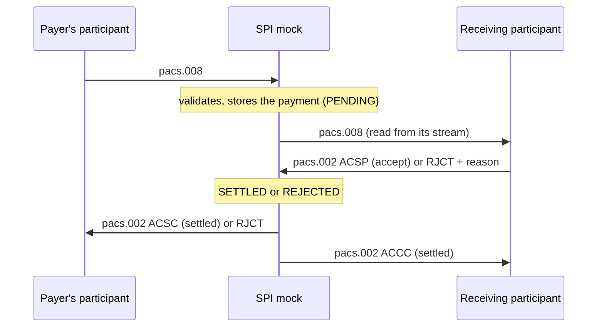

# SPI mock

Mock of the Central Bank of Brazil (Bacen) **SPI**, the Instant Payment System that settles Pix payments between
participants. **Status: in progress** (phase 2 of the [roadmap](../../docs/roadmap.md)). The message exchange (step 1) and the
payment cycle `pacs.008` to `pacs.002` (step 2) are implemented; returns (`pacs.004`), the report of transactions settled
outside the SPI (`trck.002`), the rejection rules of the simulated banks, timeouts and `admi.002` are not yet.

## What works today

The ICOM interface, as in the Interfaces manual 1.12. Go, `net/http` from the standard library, PostgreSQL.

| Endpoint | Behavior |
|----------|----------|
| `POST /api/v1/in/{ispb}/msgs` | Stores one message (`application/xml; charset=utf-8`) or up to 10 (`multipart/mixed`), gzip accepted. Answers `201` with `PI-ResourceId` (32 characters, one per message, comma separated). The content is not validated, as in the real API at this point |
| `GET /api/v1/out/{ispb}/stream/start` | Opens a read stream and reads from it. `Accept: multipart/mixed` returns up to 10 messages per response, with `PI-ResourceId` on each part |
| `GET /api/v1/out/{ispb}/stream/{token}` | Reads the next messages: `200` with messages, or `204` after waiting (long polling, `SPI_POLL_WAIT`, default 5 s). `PI-Pull-Next` carries the path of the next read |
| `DELETE /api/v1/out/{ispb}/stream/{token}` | Closes the stream and marks what it delivered as read (`200`; `410` if unknown or already closed) |
| `GET /api/v1/in/catalog`, `/out/catalog` | Message versions of the catalog package `spi.5.13.2` |

- A message not closed with `DELETE` is delivered again by the next stream, with the same `ResourceId`.
- Errors are `application/problem+xml` (RFC 7807): `400`, `404`, `405`, `406`, `410`, `411`, `413`, `415`, `503`.

### Payment cycle (`pacs.008` to `pacs.002`)

A participant sends a `pacs.008` with `POST /api/v1/in/{ispb}/msgs`; the SPI processes it right after storing it.
Rules in [`docs/catalog/data-contract.md`](docs/catalog/data-contract.md).



- **Simulated receiver.** Banco Alfa (`99000002`) and Banco Beta (`99000003`) do not read a stream: the mock answers for
  them, so the whole cycle runs inside the payer's `POST`. Today every order is accepted (`pix.AcceptAll`); the
  creditor-account rules of the decision below replace it in the rejection step.
- **Real receiver.** The wallet (`99000001`) reads the forwarded `pacs.008` from its stream and answers with a `pacs.002`
  (`ACSP` or `RJCT` with a reason). Without an answer the payment stays `PENDING` (the 40-second timeout is not built yet).
- **Rejected by the SPI** (the payer gets `RJCT` with the code; nothing is stored): `AM01` zero amount, `AM18` wrong
  `NbOfTxs`, `FF08` `EndToEndId` date more than 12 hours away, `AG12` payer and receiver are the same participant,
  `RC10` unknown receiver participant, `AGNT` payer's participant is not the sender, `AG03` salary account, `CH16` any
  other invalid or unsupported content (only `IPAY`, `MANU` and `DICT`, `HIGH` priority and `PAGPRI`).
- **Idempotent by `EndToEndId`.** A repeated order is not processed again: the payer gets the outcome that already
  exists, and a pending payment is not forwarded twice.
- **Cannot be answered, only logged:** a malformed `EndToEndId` (a `pacs.002` needs a valid one), invalid XML, and
  message types not built yet. The message is still stored. They will become `admi.002` in the rejection step.
- Several transactions in one `pacs.008` are processed one by one, with one `pacs.002` each.

### Running

```sh
make run               # starts Postgres (docker compose, port 5433) and the mock on :8081
make seed              # loads the test accounts (idempotent)
make test              # unit and HTTP tests, no database
make test-integration  # also the Postgres repository and end-to-end tests
```

Settings: `SPI_ADDR` (`:8081`), `SPI_DATABASE_URL`, `SPI_POLL_WAIT`.

### Simplifications

- No mTLS, certificates or signatures; any well-formed ISPB in the path is accepted (it is not checked against a list
  of participants yet).
- One port and one queue per participant: the primary and secondary channels are not separated.
- Parallel streams of the same participant may receive the same messages (the real SPI splits them). The participant
  deduplicates by `ResourceId`, as the manual already requires.
- The order is processed inside the sender's `POST`, not after it. No balances: the Conta PI of the participants is not
  tracked, so `AM04` never happens. A message id (`MsgId`) is not checked for repetition.
- No limit of 6 streams per participant, no token-bucket rate limit (`429`), no check of the `Host` header.
- The input/output catalog split follows the example in the Interfaces manual, updated to the versions of the package.

## Seed data

`make seed` starts Postgres if needed, applies the migrations and registers the accounts below. It is **idempotent**:
running it again changes nothing and reports what already existed; existing accounts are never overwritten.

The accounts are the same as in the [DICT seed](../dict/README.md#seed-data), with the same numbers and owners, so a key
found in the DICT can be paid in the SPI. A test reads the DICT seed file and fails if the two differ. The data lives in
[`internal/seed/data.go`](internal/seed/data.go); the account number is unique within a participant (a simplification).

| Participant | ISPB | Account | Type | Holder | Status | Behavior |
|-------------|------|---------|------|--------|--------|----------|
| Wallet | `99000001` | `0001` / `00123456` | `CACC` | Ana Souza (`52998224725`) | active | the wallet decides for itself |
| Wallet | `99000001` | `0001` / `00234567` | `SVGS` | Bruno Lima (`11144477735`) | active | the wallet decides for itself |
| Wallet | `99000001` | `0001` / `00345678` | `CACC` | Padaria Pão Quente Ltda (`11222333000181`) | active | the wallet decides for itself |
| Banco Alfa | `99000002` | `0001` / `00456789` | `CACC` | Carlos Mendes (`39053344705`) | active | accepts |
| Banco Beta | `99000003` | `0001` / `00567890` | `TRAN` | Daniela Rocha (`16899535009`) | active | accepts |
| Banco Beta | `99000003` | `0001` / `00678901` | `CACC` | Mercadinho do Zé ME (`45678912000155`) | active | accepts |
| Banco Alfa | `99000002` | `0001` / `00900001` | `CACC` | Eduardo Teixeira (`24681357928`) | **closed** | rejects with `AC07` |
| Banco Alfa | `99000002` | `0001` / `00900002` | `SVGS` | Fernanda Alves (`13579246828`) | **blocked** | rejects with `AC06` |
| Banco Beta | `99000003` | `0001` / `00900003` | `TRAN` | Gustavo Pires (`86420975310`) | active | **never answers**: the SPI rejects with `AB03` after 40 s |

The last three are the test accounts of the [receiving participant decision](#receiving-participant-decision). They have
DICT keys (CPF and phone) too, so the whole path can be exercised: look the key up, then pay it.

The seed only stores the accounts. The processor does not use them yet, so today every payment to Alfa or Beta is
accepted; the rules arrive in the rejection step of the [roadmap](../../docs/roadmap.md).

## Specification source (decision)

Unlike the DICT, which has a public OpenAPI file, the SPI is specified by **PDF manuals plus a message catalog (XSD)**,
published by Bacen. The mock is built from these documents, and Bacen documentation stays the source of truth.

Downloaded from bcb.gov.br on **2026-11-14** and kept in [`docs/`](docs/):

| File | What it is | Version | Size / pages |
|------|------------|---------|--------------|
| [`Manual-das-Interfaces-de-Comunicacao-1.12.pdf`](docs/Manual-das-Interfaces-de-Comunicacao-1.12.pdf) | Communication interfaces of the SPI (ICOM) and the DICT: how participants send and receive messages | 1.12, published by IN BCB nº 695 of 2025-12-23 | 677 KB, 32 pages |
| [`Manual-de-Fluxos-Efetivacao-do-Pix.pdf`](docs/Manual-de-Fluxos-Efetivacao-do-Pix.pdf) | Pix settlement flows, including returns | Current file at the Bacen URL; version not read | 5.3 MB, 103 pages |
| [`Manual-de-Tempos-do-Pix.pdf`](docs/Manual-de-Tempos-do-Pix.pdf) | Time limits of the Pix process | Current file at the Bacen URL; version not read | 1.1 MB, 35 pages |

SHA-256, to detect when Bacen replaces a file:

```
913d7f0a8274c1e86aa7b3990021a83fb5a20fb003c85414af71b42ecb779fa9  Manual-das-Interfaces-de-Comunicacao-1.12.pdf
0c312291c48ab12d973f5ef62bdd83a6ade75b178daa7852650877740fe7ebca  Manual-de-Fluxos-Efetivacao-do-Pix.pdf
edf73b0a457a18053496426a96673ad64ed6b97ef58e12c0366e097dd70f48b4  Manual-de-Tempos-do-Pix.pdf
```

Sources:

- https://www.bcb.gov.br/content/estabilidadefinanceira/cedsfn/Manual%20das%20Interfaces%20de%20Comunica%C3%A7%C3%A3o-1.12.pdf
- https://www.bcb.gov.br/content/estabilidadefinanceira/pix/Regulamento_Pix/III_ManualdeFluxosdoProcessodeEfetivacaodoPix.pdf
- https://www.bcb.gov.br/content/estabilidadefinanceira/pix/Regulamento_Pix/IX_ManualdeTemposdoPix.pdf

> **Spec reference:** the mock will follow the Manual das Interfaces de Comunicação **v1.12**, as available on the Bacen
> site on **2026-11-14**. If Bacen publishes a newer version after that date, contracts here may differ from the real
> service.

## Still missing

- **Message catalog: collected.** Catálogo de Serviços do SFN Volume VI **5.13** and package `spi.5.13.2.zip` (XSD,
  XLSX, samples), downloaded on 2026-11-14 and kept in [`docs/catalog/`](docs/catalog/README.md), together with the
  Manual de Padrões para Iniciação do Pix 2.10.0 and the secondary channel guide. Confirm on the Bacen
  `comunicacaodados` page that no newer package exists before building.
- **Manual versions of Fluxos and Tempos.** Read from the documents: Fluxos is **2.1** (version 2.2 takes effect on
  2027-02-01) and Tempos is **7.0**. The table above still says "version not read".
- **Content review.** The Interfaces manual was read. The SPI delivery model is **pull**: the participant sends with
  `POST /api/v1/in/{ispb}/msgs` and reads with long polling on `GET /api/v1/out/{ispb}/stream/start`, following the
  `PI-Pull-Next` header. The ISPB is in the path, so the `X-Participant-ISPB` header planned in the roadmap is not
  needed for the SPI. The Fluxos and Tempos manuals were read only where needed (settlement flow, return, time limits).
- **Receiving participant: decided**, see the section below.

## Receiving participant (decision)

In the settlement flow, the receiving participant validates the creditor account and answers the SPI before the payment
settles. The seed banks do not exist, so:

- **Banco Alfa (`99000002`) and Banco Beta (`99000003`) are simulated by the mock.** When a `pacs.008` is addressed to
  them, the mock answers with a `pacs.002` on their behalf.
- **The wallet (`99000001`) is a real participant.** The order goes to its stream (`/api/v1/out/99000001/...`) and the
  wallet must answer. If it does not, the SPI rejects at the 40-second limit with `AB03`.
- **Accept by default.** The simulated bank answers `ACSP`, the SPI settles and sends `ACSC` to the payer's participant and `ACCC` to the receiver's.
- **Rejections are chosen by the creditor account**, evaluated in this order, so a test picks the outcome by picking
  whom to pay:

| Creditor account in the `pacs.008` | Answer |
|------------------------------------|--------|
| Not in the seed | `RJCT` `AC03` (invalid account) |
| Seeded test account `00900001` (Banco Alfa), closed | `RJCT` `AC07` |
| Seeded test account `00900002` (Banco Alfa), blocked | `RJCT` `AC06` |
| Seeded test account `00900003` (Banco Beta), never answers | no answer; the SPI rejects with `AB03` after 40 s |
| Account exists but the creditor document differs from its owner | `RJCT` `BE01` |
| Any other seeded account | `ACSP` |

The SPI itself rejects, before the receiving participant is asked, an order whose payer and receiver are the same
participant (`AG12`, book transfer not allowed), as in the real SPI.

Notes:

- The test accounts are in the [seed](#seed-data), together with their DICT keys, so the whole path (lookup, then
  payment) can be exercised.
- The meaning of each reason code, and which side generates it, is in the
  [data contract](docs/catalog/data-contract.md#reason-codes). `AB03` is generated by the SPI (timeout), the others in
  the table by the receiving participant.
- The timeout case uses the real 40 seconds, with a configuration to shorten it in tests.
- Not covered: rejection for insufficient balance (the wallet checks the payer before sending) and liquidity
  management of the participants' Conta PI, which stays out of scope.

## Next steps

Follow phase 2 of the [roadmap](../../docs/roadmap.md#phase-2-spi-mock-next): finish the specification intake above,
then the delivery model, `pacs.008`, `pacs.002`, `pacs.004` and the report of transactions settled outside the SPI.
