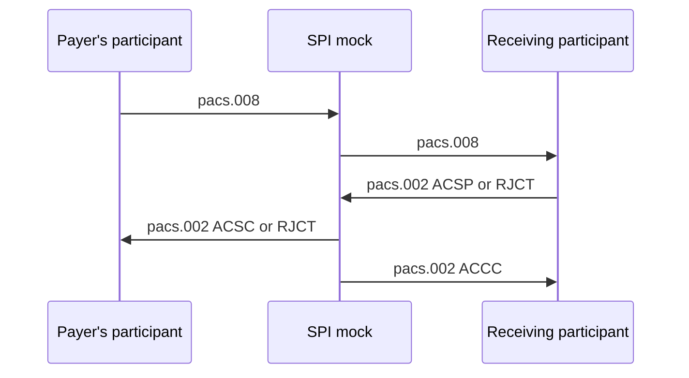

# SPI mock

The Bacen **SPI**, which settles Pix between participants: the ICOM interface (Interfaces manual 1.12) and the ISO 20022
messages of catalog package `spi.5.13.2`. Go, `net/http`, PostgreSQL. Exercised with the DICT mock by the closing tests
in [`e2e/`](../../e2e) (`make e2e` at the repo root).

## Running

```sh
make run               # Postgres on :5433 + the mock on :8081
make seed              # test accounts (idempotent)
make test              # unit and HTTP, no database
make test-integration  # everything, on Postgres
```

| Variable | Default | |
|----------|---------|-|
| `SPI_ADDR` | `:8081` | |
| `SPI_DATABASE_URL` | | |
| `SPI_POLL_WAIT` | `5s` | long-poll wait |
| `SPI_TIMEOUT` | `40s` | how long a payment waits for the receiver; shorten it to test `AB03` |
| `SPI_RETENTION` | `168h` | read messages are deleted after this; unread ones stay |
| `SPI_CONTROL` | on | `off` removes `/mock` |
| `SPI_DICT_URL` | | the DICT mock told of every settled payment (`http://localhost:8080`); empty tells no one |
| `OTEL_EXPORTER_OTLP_ENDPOINT` | | telemetry; empty sends nothing |

Metrics of its own: `spi.payments.finalized`, `spi.orders.refused`, `spi.dict.notifications`.

## Messages

| Message | Status |
|---------|--------|
| `pacs.008` credit transfer | `IPAY`, `MANU` and `DICT`, `HIGH` priority |
| `pacs.002` status | `ACSP`, `ACSC`, `ACCC`, `RJCT` |
| `pacs.004` return | `MD06`, and `BE08`/`FR01` of the MED; partial returns |
| `trck.002` report / `camt.025` receipt | yes |
| `admi.002` error notification | invalid XML, unsupported message, bad identifier |
| `pibr.*`, `camt.0xx` queries, `reda.*`, cancellation, Pix Automático | not built (`admi.002`) |

Pix Saque/Troco (`SL02`), Split Payment, scheduled payments, QR/NFC initiation and `PAGFRD` get `CH16`. Rules per
field: [`docs/catalog/data-contract.md`](docs/catalog/data-contract.md).

## Endpoints

| Endpoint | |
|----------|-|
| `POST /api/v1/in/{ispb}/msgs` | one message, or up to 10 as `multipart/mixed`; gzip ok. `201` + `PI-ResourceId` |
| `GET /api/v1/out/{ispb}/stream/start` | opens a stream; `multipart/mixed` gives up to 10 per answer |
| `GET /api/v1/out/{ispb}/stream/{token}` | `200` with messages, or `204` after the long poll; `PI-Pull-Next` has the next path |
| `DELETE /api/v1/out/{ispb}/stream/{token}` | marks what was read (`410` for a bad or stale token) |
| `GET /api/v1/in/catalog`, `/out/catalog` | message versions |

An unknown `{ispb}` is `403`. What isn't closed with `DELETE` comes again with the same `ResourceId`; closing twice is
fine. Errors are `problem+xml`.

## Payment cycle



- **Simulated banks.** Banco Alfa and Banco Beta answer inside the payer's `POST` ([accounts](#seed-data)). The wallet
  is real and answers through its stream; no answer within `SPI_TIMEOUT` is `AB03`.
- **The SPI rejects** `AM01` zero amount, `AM18` wrong `NbOfTxs`, `FF08` an `EndToEndId` date off by more than 12 h,
  `AG12` same participant on both sides, `RC10` unknown receiver, `AGNT` sender is not the payer's participant, `AG03`
  salary account, `CH16` anything else unsupported.
- **Idempotent** by `EndToEndId` for 24 h: a repeat gets the existing outcome and isn't forwarded again.
- **Returns (`pacs.004`)** go through the same cycle the other way; the `pacs.002` carries the `RtrId` as
  `OrgnlInstrId`. The SPI rejects `DT05` (over 90 days), `AG13` (return of a return) and `CH16` (original missing, not
  settled, or not received by the sender); the receiver can reject `AM09` (returns above the original). The MED
  reasons follow the same rules.
- **Reports (`trck.002`)** record transactions settled outside the SPI (book transfers), one `camt.025` per transaction:
  `ACPT`, or `RJCT` with `FF08` (over 30 days or in the future), `AM01`, `RC09`/`RC10`, `AG01` (`BOK2`), `AM18`, `DT02`,
  `ED05`. Reporting twice is accepted.
- A message the SPI can't process gets an `admi.002` naming its `PI-ResourceId`.

## The DICT learns what settles

With `SPI_DICT_URL` set, every `pacs.008` that settles is sent to the DICT mock's `POST /mock/transactions`
(participants, tax ids, the key paid, amount, settlement time), so the MED can take a report or refund on it.

- The settled payments not sent yet are an outbox in the `payments` table: settling and queueing are the same update.
- A worker sends them every second, oldest first, waiting longer while the DICT is down (up to a minute). One the DICT
  refuses as invalid is logged and dropped.
- Payments settled more than 90 days ago, returns and `trck.002` reports are not sent.

## Seed data

Same accounts as the [DICT seed](../dict/README.md#seed-data) ([`internal/seed/data.go`](internal/seed/data.go)); a test
fails if the two differ, or if an account is missing here. A simulated bank answers by creditor account: no such
account (or another branch) is `AC03`, a holder document that differs from the account's is `BE01`.

| Participant | Account | Holder | Answers |
|-------------|---------|--------|---------|
| Wallet `99000001` | `00123456` `CACC`, `00234567` `SVGS`, `00345678` `CACC` | Ana Souza, Bruno Lima, Padaria Pão Quente | the wallet decides |
| Banco Alfa `99000002` | `00456789` `CACC` | Carlos Mendes | accepts |
| Banco Beta `99000003` | `00567890` `TRAN`, `00678901` `CACC` | Daniela Rocha, Mercadinho do Zé | accepts |
| Banco Alfa | `00900001` `CACC` | Eduardo Teixeira | `AC07` (closed) |
| Banco Alfa | `00900002` `SVGS` | Fernanda Alves | `AC06` (blocked) |
| Banco Beta | `00900003` `TRAN` | Gustavo Pires | never answers: `AB03` after the timeout |
| Banco Alfa | `00900004` `CACC` | Helena Moraes | `DS04` |
| Banco Beta | `00900005` `SVGS` | Igor Batista | `FRAD` |
| Banco Alfa | `00900006` `TRAN` | Julia Nogueira | `AM02` |
| Banco Beta | `00900007` `SVGS` | Kleber Duarte | `AG03` |
| Banco Alfa | `00900008` `CACC` | Larissa Prado | `ED05` |
| Banco Beta | `00900009` `TRAN` | Marcos Vieira | `AB09` |
| Banco Alfa | `00900010` `CACC` | Natalia Freitas | `AC14` |
| Banco Beta | `00900011` `SVGS` | Otavio Ramos | `CH11` |

All branches are `0001`.

## Control API

JSON under `/mock`, not part of Bacen's contract. Examples in the [integration guide](../../docs/integration-guide.md#the-control-api).

| | |
|-|-|
| `GET /mock/accounts` | test accounts and how each answers |
| `GET /mock/payments[?status=&kind=&participant=&limit=]`, `/mock/payments/{id}` | payments and returns |
| `GET /mock/reports/{id}` | a reported transaction |
| `GET /mock/messages[?participant=&direction=in\|out&limit=]` | messages with their XML |
| `POST /mock/inbound/payments` | a simulated bank pays someone (the wallet, usually) |
| `POST /mock/inbound/returns` | a simulated bank returns a payment it received (`reason` `MD06`, `BE08` or `FR01`) |
| `POST /mock/reset` | clears messages, payments, reports and faults |
| `POST /mock/faults`, `GET`, `DELETE /mock/faults[/{id}]` | `429`/`503` with `Retry-After`, or slow answers |

The inbound endpoints build the message a real bank would send and push it through the normal path.

## Simplifications

- No mTLS or signatures; the `{ispb}` in the path is the only identification.
- One port and one queue per participant (no primary/secondary split); parallel streams may see the same messages, so
  dedupe by `ResourceId`.
- Orders are processed inside the sender's `POST`. No Conta PI balances (no `AM04`), no 6-stream limit, no rate limit
  of its own, no `Host` check. `MsgId` repeats aren't checked.

## Specification source

The SPI has no OpenAPI file: it's PDF manuals plus the message catalog (XSD), downloaded from bcb.gov.br on 2026-11-14
and kept in [`docs/`](docs/): Interfaces 1.12, Fluxos 2.1, Tempos 7.0, and the catalog in
[`docs/catalog/`](docs/catalog/README.md). SHA-256, to notice when Bacen replaces a file:

```
913d7f0a8274c1e86aa7b3990021a83fb5a20fb003c85414af71b42ecb779fa9  Manual-das-Interfaces-de-Comunicacao-1.12.pdf
0c312291c48ab12d973f5ef62bdd83a6ade75b178daa7852650877740fe7ebca  Manual-de-Fluxos-Efetivacao-do-Pix.pdf
edf73b0a457a18053496426a96673ad64ed6b97ef58e12c0366e097dd70f48b4  Manual-de-Tempos-do-Pix.pdf
```
