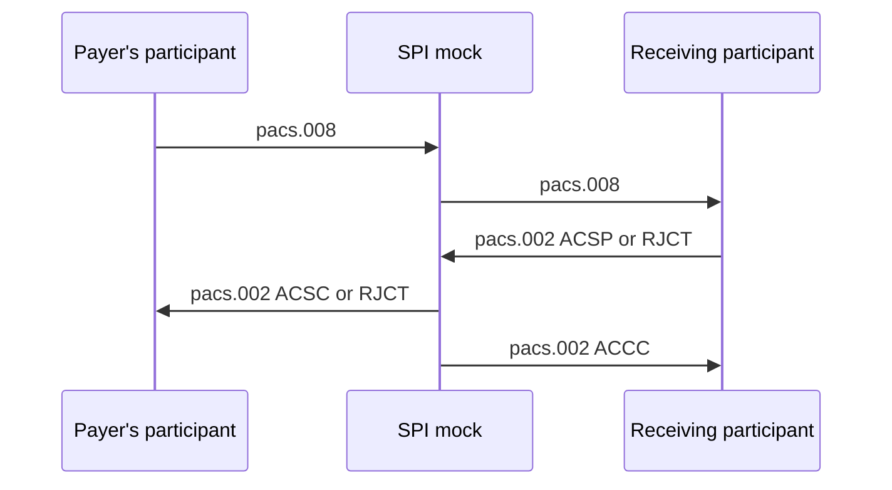

# SPI mock

The Bacen **SPI**, which settles Pix between participants: the ICOM interface (Interfaces manual 1.12) and the ISO 20022
messages of catalog package `spi.5.13.2`. Go, `net/http`, PostgreSQL. Exercised with the DICT mock by the
[closing test](../../e2e/closing_test.go) (`make e2e` at the repo root).

## Running

```sh
make run               # Postgres on :5433 + the mock on :8081
make seed              # test accounts (idempotent)
make test              # unit and HTTP, no database
make test-integration  # everything, on Postgres
```

| Variable | Default | |
|----------|---------|-|
| `SPI_ADDR` | `:8081` | |
| `SPI_DATABASE_URL` | | |
| `SPI_POLL_WAIT` | `5s` | long-poll wait |
| `SPI_TIMEOUT` | `40s` | how long a payment waits for the receiver; shorten it to test `AB03` |
| `SPI_RETENTION` | `168h` | read messages are deleted after this; unread ones stay |
| `SPI_CONTROL` | on | `off` removes `/mock` |
| `SPI_DICT_URL` | | the DICT mock (`http://localhost:8080`) told of every settled payment, for the MED; empty tells no one |
| `OTEL_EXPORTER_OTLP_ENDPOINT` | | traces, metrics and logs; empty sends nothing. Metrics of its own: `spi.payments.finalized`, `spi.orders.refused`, `spi.dict.notifications` |

## Messages

| Message | Status |
|---------|--------|
| `pacs.008` credit transfer | `IPAY`, `MANU` and `DICT`, `HIGH` priority |
| `pacs.002` status | `ACSP`, `ACSC`, `ACCC`, `RJCT` |
| `pacs.004` return | `MD06`, `BE08` and `FR01` (MED), partial returns |
| `trck.002` report / `camt.025` receipt | yes |
| `admi.002` error notification | invalid XML, unsupported message, bad identifier |
| `pibr.*`, `camt.0xx` queries, `reda.*`, cancellation, Pix Automático | not built (`admi.002`) |

Pix Saque/Troco (`SL02`), Split Payment, scheduled payments, QR/NFC initiation and `PAGFRD` get `CH16`.

## Endpoints

| Endpoint | |
|----------|-|
| `POST /api/v1/in/{ispb}/msgs` | one message, or up to 10 as `multipart/mixed`; gzip ok. `201` + `PI-ResourceId` |
| `GET /api/v1/out/{ispb}/stream/start` | opens a stream; `multipart/mixed` gives up to 10 per answer |
| `GET /api/v1/out/{ispb}/stream/{token}` | `200` with messages, or `204` after the long poll. `PI-Pull-Next` has the next path |
| `DELETE /api/v1/out/{ispb}/stream/{token}` | marks what was read (`410` for a bad or stale token) |
| `GET /api/v1/in/catalog`, `/out/catalog` | message versions |

An unknown `{ispb}` is `403`. What isn't closed with `DELETE` comes again with the same `ResourceId`. The token is just
a queue position, so closing twice is fine. Errors are `problem+xml`.

## Payment cycle



- Banco Alfa and Banco Beta are simulated: the mock answers for them inside the payer's `POST`. The wallet is real and
  answers through its stream; no answer in `SPI_TIMEOUT` is `AB03`.
- The SPI itself rejects: `AM01` zero amount, `AM18` wrong `NbOfTxs`, `FF08` `EndToEndId` date off by more than 12 h,
  `AG12` same participant on both sides, `RC10` unknown receiver, `AGNT` sender is not the payer's participant, `AG03`
  salary account, `CH16` anything else unsupported.
- Idempotent by `EndToEndId` for 24 h: a repeat gets the existing outcome and isn't forwarded again.
- A message the SPI can't process gets an `admi.002` naming its `PI-ResourceId`.

Rules per field: [`docs/catalog/data-contract.md`](docs/catalog/data-contract.md).

**Returns (`pacs.004`)** go through the same cycle in the other direction; the `pacs.002` carries the `RtrId` as
`OrgnlInstrId`. The SPI rejects `DT05` (over 90 days), `AG13` (return of a return), `CH16` (original missing, not
settled, or not received by the sender). The receiver can reject `AM09` (returns above the original; rejected returns
don't count) and the account rules below. Reasons `MD06` (the receiver asked), and for the MED `BE08` (operational
flaw) and `FR01` (fraud), with the same rules.

**The DICT learns the settled payments.** With `SPI_DICT_URL` set, every `pacs.008` that settles is sent to the DICT
mock's `POST /mock/transactions` (participants, tax ids, the key paid, amount and settlement time), so the MED can take
a report or refund on it. The settled payments not sent yet are an outbox in the `payments` table: settling and queueing
are the same update, and a worker sends them every second, the oldest first, waiting longer while the DICT is down (up to
a minute). One the DICT refuses as invalid is logged and dropped. Payments settled more than 90 days ago are not sent.
Returns and `trck.002` reports are not sent.

**Reports (`trck.002`)** record transactions settled outside the SPI (book transfers). One `camt.025` receipt per
transaction: `ACPT`, or `RJCT` with `FF08` (over 30 days or in the future), `AM01`, `RC09`/`RC10`, `AG01` (`BOK2`: every
participant here settles for itself), `AM18` (0 or over 500), `DT02`, `ED05`. Reporting twice is accepted.

## Receiving participant (decision)

The simulated banks answer by creditor account, in this order (`pix.AccountResponder`):

| Creditor account in the `pacs.008` | Answer |
|------------------------------------|--------|
| No such account at the participant, or another branch | `RJCT` `AC03` (invalid account) |
| Seeded test account `00900001` (Banco Alfa), closed | `RJCT` `AC07` |
| Seeded test account `00900002` (Banco Alfa), blocked | `RJCT` `AC06` |
| Seeded test account `00900003` (Banco Beta), never answers | no answer; the SPI rejects with `AB03` after 40 s |
| Seeded test accounts `00900004` to `00900011` | `RJCT` with `DS04`, `FRAD`, `AM02`, `AG03`, `ED05`, `AB09`, `AC14` or `CH11` (see the seed table) |
| Account exists but the creditor document differs from its owner | `RJCT` `BE01` |
| Any other seeded account | `ACSP` |

## Seed data

Same accounts as the [DICT seed](../dict/README.md#seed-data); a test fails if the two differ. Data in
[`internal/seed/data.go`](internal/seed/data.go).

| Participant | ISPB | Account | Type | Holder | Status | Behavior |
|-------------|------|---------|------|--------|--------|----------|
| Wallet | `99000001` | `0001` / `00123456` | `CACC` | Ana Souza (`52998224725`) | active | the wallet decides for itself |
| Wallet | `99000001` | `0001` / `00234567` | `SVGS` | Bruno Lima (`11144477735`) | active | the wallet decides for itself |
| Wallet | `99000001` | `0001` / `00345678` | `CACC` | Padaria Pão Quente Ltda (`11222333000181`) | active | the wallet decides for itself |
| Banco Alfa | `99000002` | `0001` / `00456789` | `CACC` | Carlos Mendes (`39053344705`) | active | accepts |
| Banco Beta | `99000003` | `0001` / `00567890` | `TRAN` | Daniela Rocha (`16899535009`) | active | accepts |
| Banco Beta | `99000003` | `0001` / `00678901` | `CACC` | Mercadinho do Zé ME (`45678912000155`) | active | accepts |
| Banco Alfa | `99000002` | `0001` / `00900001` | `CACC` | Eduardo Teixeira (`24681357928`) | **closed** | rejects with `AC07` |
| Banco Alfa | `99000002` | `0001` / `00900002` | `SVGS` | Fernanda Alves (`13579246828`) | **blocked** | rejects with `AC06` |
| Banco Beta | `99000003` | `0001` / `00900003` | `TRAN` | Gustavo Pires (`86420975310`) | active | **never answers**: the SPI rejects with `AB03` after 40 s |
| Banco Alfa | `99000002` | `0001` / `00900004` | `CACC` | Helena Moraes (`10293847541`) | active | rejects with `DS04` |
| Banco Beta | `99000003` | `0001` / `00900005` | `SVGS` | Igor Batista (`56473829164`) | active | rejects with `FRAD` |
| Banco Alfa | `99000002` | `0001` / `00900006` | `TRAN` | Julia Nogueira (`91827364564`) | active | rejects with `AM02` |
| Banco Beta | `99000003` | `0001` / `00900007` | `SVGS` | Kleber Duarte (`37281946546`) | active | rejects with `AG03` |
| Banco Alfa | `99000002` | `0001` / `00900008` | `CACC` | Larissa Prado (`64528193728`) | active | rejects with `ED05` |
| Banco Beta | `99000003` | `0001` / `00900009` | `TRAN` | Marcos Vieira (`82910476340`) | active | rejects with `AB09` |
| Banco Alfa | `99000002` | `0001` / `00900010` | `CACC` | Natalia Freitas (`45197286300`) | active | rejects with `AC14` |
| Banco Beta | `99000003` | `0001` / `00900011` | `SVGS` | Otavio Ramos (`73640812913`) | active | rejects with `CH11` |

## Control API

JSON under `/mock`, not part of Bacen's contract. Examples in the [integration guide](../../docs/integration-guide.md#the-control-api).

| | |
|-|-|
| `GET /mock/accounts` | test accounts and how each answers |
| `GET /mock/payments[?status=&kind=&participant=&limit=]`, `/mock/payments/{id}` | payments and returns |
| `GET /mock/reports/{id}` | a reported transaction |
| `GET /mock/messages[?participant=&direction=in\|out&limit=]` | messages with their XML |
| `POST /mock/inbound/payments` | a simulated bank pays someone (the wallet, usually) |
| `POST /mock/inbound/returns` | a simulated bank returns a payment it received (`reason` `MD06`, or `BE08`/`FR01` of the MED) |
| `POST /mock/reset` | clears messages, payments, reports and faults |
| `POST /mock/faults`, `GET`, `DELETE /mock/faults[/{id}]` | `429`/`503` with `Retry-After`, or slow answers |

The inbound endpoints build the message a real bank would send and push it through the normal path.

## Simplifications

- No mTLS or signatures; the `{ispb}` in the path is the only identification.
- One port and one queue per participant (no primary/secondary channel split); parallel streams may see the same
  messages, so dedupe by `ResourceId`.
- Orders are processed inside the sender's `POST`. No Conta PI balances, so no `AM04`. `MsgId` repeats aren't checked.
- No 6-stream limit, no rate limit of its own, no `Host` check.

## Specification source

The SPI has no OpenAPI file: it's PDF manuals plus the message catalog (XSD), downloaded from bcb.gov.br on 2026-11-14
and kept in [`docs/`](docs/): Interfaces 1.12, Fluxos 2.1, Tempos 7.0, and the catalog in
[`docs/catalog/`](docs/catalog/README.md). SHA-256, to notice when Bacen replaces a file:

```
913d7f0a8274c1e86aa7b3990021a83fb5a20fb003c85414af71b42ecb779fa9  Manual-das-Interfaces-de-Comunicacao-1.12.pdf
0c312291c48ab12d973f5ef62bdd83a6ade75b178daa7852650877740fe7ebca  Manual-de-Fluxos-Efetivacao-do-Pix.pdf
edf73b0a457a18053496426a96673ad64ed6b97ef58e12c0366e097dd70f48b4  Manual-de-Tempos-do-Pix.pdf
```
